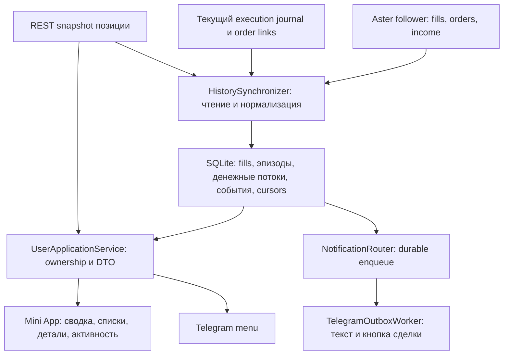

# Mini App: функциональное наполнение и история сделок

Дата: 2026-09-05. База анализа: текущий код, HEAD `0db6c84`.

Статус на 2026-09-06: **S1 backend реализуется; G1 не принят; S2/S3 и G1–G3 открыты**.
Ниже сохраняются исходные решения и критерии, а фактический ход реализации
ведётся в `MINIAPP_FUNCTIONAL_PROGRESS_2026-09.md`.
Подтверждено владельцем: показываем результат аккаунта фолловера, его объёмы,
исполнения и PnL. Визуальный стиль и четыре основные вкладки сохраняются.
Уточнение владельца: backend входит в обязательный объём этой кампании;
целевой результат — законченный сценарий истории и результата в Mini App и боте.

**Актуальный порядок: S1 Backend → G1 → S2 Скорость → G2 → S3 Интерфейс и
функциональность → G3.** Подробный исполняемый план — §14. Обозначения H/B/F
ниже — пакеты работ и ссылки прежней редакции, не отдельная последовательность
этапов. При расхождении порядка руководствоваться §14. S1 — IN PROGRESS;
S2/S3 — PLANNED; G1–G3 — OPEN.

## 1. Решение

Приложению нужен переход от экрана состояния сервиса к повседневному обзору
своего торгового аккаунта. Цвета, типографика, панели и нижняя навигация уже
дают подходящую основу. Основной объём изменений — состав информации,
связи между экранами и достоверные данные о сделках.

Предлагаемая структура:

| Поверхность | На какой вопрос отвечает | Основное изменение |
|---|---|---|
| Главная | Что сейчас с моим аккаунтом и требуется ли действие? | Общий PnL открытых позиций, их количество и состояние защиты вместо первой позиции |
| Позиции → Открытые | Какие позиции у меня сейчас? | Первые 3 компактные карточки, «Показать все», переход в подробности |
| Позиции → Закрытые | Чем закончились мои сделки? | Первые 3 завершённых эпизода, результат, период удержания, полная история |
| Детали сделки | Что именно произошло с этой позицией? | Объём, цены, частичные исполнения, SL/TP, результат и последовательность событий |
| Активность | Что изменилось и почему? | Пользовательские события с числами и ссылкой на ту же сделку |
| Настройки | Какие параметры я могу менять и что это означает? | Текущие значения, реальный денежный пример риска, понятное подключение и помощь |
| Уведомление бота | Что произошло с моими деньгами/позицией? | Направление, исполненный объём, цена/результат, кнопка «Открыть сделку» |

**Критическая зависимость:** закрытая позиция фолловера — новая модель данных.
Её нельзя получить переименованием `MARKET_CLOSE` в существующей активности.
Нужны реальные исполнения и устойчивый идентификатор эпизода.

## 2. Основание анализа и его границы

Прочитаны корневой `AGENTS.md`, `miniapp/AGENTS.md`, `PRODUCT.md`; проверены
все 13 файлов экранов в `miniapp/src/screens/`, `App.tsx`, `components/AppShell.tsx`,
`components/ui.tsx`, `navigation.ts`, `types.ts`, `api.ts`, `index.css`,
view-model/helpers Home, Activity, Settings, Risk, Notifications, Status,
AccountBuilder, formatting, revalidation и Telegram wrapper.

Для реализуемости проверены `application/models.py`, соответствующие методы
`application/service.py` и `application/adapters.py`, HTTP boundary
`miniapp/server.py`, модели и клиент `aster/`, журнал и связи в `storage/`,
подтверждение ордеров `trading/executor.py`, построение follower snapshot и
расчёт риска, `notifications/{models,formatter,router,worker}.py`,
presenter активности и dashboard в `telegram/menu.py`.

Просмотрены все 12 PNG в `docs/reports/acceptance-p27/`: четыре корневые
вкладки, Risk, Status, AccountBuilder, pause/resume и состояния Notifications.
Это визуальная база от 3 сентября; поведение определяется текущим кодом.
В частности, на снимке Positions нет открытой позиции: по нему нельзя
оценить плотность списка из нескольких реальных карточек. Карточка с данными
оценивалась по JSX/CSS. Изображений onboarding, recovery, Help и Security
в этом наборе нет — эти поверхности проверены по реализации.

Это анализ и план, не новый live acceptance. Движок, кошельки, бот и торговые
операции для исследования не запускались. Исторические документы использованы
только для контекста инвариантов; новые выводы ниже привязаны к текущему коду.

Impeccable применён в режиме `shape`, рабочий режим поверхности — `Operate`:
быстрое чтение состояния, понятные действия, последовательное раскрытие деталей.
Отсутствие `DESIGN.md` не трактуется как разрешение на редизайн: визуальная
истина — существующий CSS и снимки.

## 3. Почему сейчас ощущается «макет»: конкретные находки

Приоритеты: P1 — неверное/недостаточное понимание результата или действия;
P2 — плотность, навигация, качество повседневного использования.
Это приоритеты нового UX-плана, не переоткрытие прежнего acceptance движка.

| Приоритет | Факт в текущем коде | Последствие | Предлагаемое исправление |
|---|---|---|---|
| P1 | `HomeScreen.fetchAll()` выбирает `positions[0]`; backend сортирует позиции по symbol | Одна алфавитно первая позиция выглядит как представление всего аккаунта | Агрегат по полному snapshot, отдельные переходы к списку и проблемам защиты |
| P2 | Home: trust rail + крупная карточка «Всё работает» + крупная кнопка паузы | Большая часть экрана сообщает состояние подключения; полезные числа ниже | Сжать статус, вынести техническую детализацию в подключение/диагностику |
| P1 | `PositionSummaryDTO.qty` существует, но `PositionCard` его не выводит | Нельзя понять размер собственного участия | Количество с единицей актива в карточке и деталях |
| P2 | `PositionsScreen` выводит все развёрнутые карточки без ограничения | Список плохо сканируется и растёт вертикально | Краткий список → полный список → детали |
| P1 | Нет closed-position DTO, repository и API | Полноценная история в UI сейчас не существует | Добавить историю исполнений и эпизоды фолловера |
| P1 | `_safe_activity_title()` выбирает «Открыта/Закрыта» по kind, отдельно от status | Даже неуспешная команда может иметь заголовок совершённого действия; сокращение называется закрытием | Событие определяется фактическим изменением позиции; ожидание/ошибка имеют отдельный текст |
| P1 | `_safe_activity_status()` объединяет UNKNOWN и FAILED | Неизвестный исход выглядит доказанной ошибкой | «Проверяем результат на бирже» отдельно от «Не выполнено» |
| P1 | `ActivityItem` не содержит id, side, qty, price, PnL, ссылки | Событие невозможно сопоставить с конкретной сделкой | Стабильные публичные refs и структурированные поля |
| P2 | Активность сортируется по изменяемому `updated_at`, используется OFFSET; append не дедуплицирует | Новые/обновлённые команды могут сдвигать страницы | Неизменяемые события + cursor/high-watermark; клиентская дедупликация |
| P2 | При `page > 0` Activity пропускает ревалидацию; append failure скрыт | Долгая сессия не показывает новые события, «ещё» может молча не сработать | Неблокирующая плашка новых событий, явная ошибка догрузки с повтором |
| P2 | `dayBucket()` группирует по UTC, `formatTime()` выводит локальное время; `now` фиксируется при mount | «Сегодня» расходится со временем пользователя, особенно после полуночи | Единый часовой пояс устройства и обновление групп при возврате/смене дня |
| P1 | `RESUME_CONFIRM_BODY` всегда утверждает «Мастер сейчас в позиции» | Текст не опирается на DTO подтверждения | Серверный контекст подтверждения либо нейтральное условное объяснение |
| P1 | Success: «Копирование начнётся с новых входов мастера» | Противоречит возможности входа в уже открытую позицию при resume | Объяснить реальное поведение текущего resume |
| P1 | AccountBuilder использует truthy boolean для nullable permissions | Отсутствие информации может выглядеть как подтверждённый запрет вывода | Отдельное отображение true / false / unknown |
| P1 | Help отправляет за подключением/отключением в бот, хотя эти действия есть в Mini App | Пользователь получает неверную инструкцию; emergency не отделён от прав администратора | Переписать справку по фактическим capability и дать работающие переходы |
| P2 | Risk использует `RISK_DEMO_BALANCE_USDT = 1240` | Даже честно подписанный пример выглядит демонстрационным | Пример по реальной доступной сумме, отдельно от сохранения настройки |
| P2 | «Безопасный журнал», «Показаны только данные без секретов», «Управляет торговое ядро» | Пользователю объясняют реализацию вместо результата | Убрать постоянные служебные пояснения, сохранить полезные последствия действий |
| P1 | Home и Settings могут сохранять старый положительный текст после сбоя; Positions фоновые ошибки скрывает | Последний успешный ответ выглядит текущим состоянием | Общая видимая freshness-модель и отдельный transport-stale |
| P2 | `formatPrice()` ограничивает вывод 4 знаками; PnL округляется до 2 | Малые ненулевые цены/результаты могут выглядеть нулём | Точность инструмента, безопасный вывод малых значений |
| P2 | Activity читает `window.Telegram` напрямую в `hapticTap()` | Расхождение с boundary `telegram.ts` | Использовать существующий wrapper |

Бот уже богаче Mini App: `format_confirmed_action()` выводит quantity и иногда
LONG/SHORT, а для защиты — уровень. Но quantity берётся из запроса, единица
отсутствует, для BOTH направление теряется, фактических цен/PnL/ссылки нет.
Кроме того, `CommandRepo.confirmed()` при recovery не выбирает payload, который
пытается использовать formatter: восстановленное уведомление может лишиться
symbol/объёма. Новая доставка должна восстанавливаться из сохранённого
пользовательского события, а не повторно угадывать сообщение из команды.

## 4. Продуктовый контракт

### 4.1 Что сохраняем

- Четыре вкладки: Главная, Позиции, Активность, Настройки.
- Палитру `--canvas`, `--surface`, `--champagne`, семантические цвета,
  системный шрифт, tabular numerals, существующий язык панелей и кнопок.
- Read-only позиции; риск — единственная числовая настройка фолловера.
- Разрешения, pause/resume, подтверждение с TTL и fail-closed проверки backend.
- Mount-all/keep-alive вкладок, восстановление scroll, native BackButton/Haptics.
- Один Python process, SQLite WAL, общий application layer для бота и Mini App.

### 4.2 Что означает «моя сделка»

В UI «сделка» — **непрерывный эпизод позиции фолловера** по конкретному
инструменту и направлению: от фактического выхода из нуля до возврата в ноль.
Добавление объёма и частичное сокращение относятся к тому же эпизоду.
Повторный вход после нуля — новый эпизод, даже если symbol совпадает.
В HEDGE LONG и SHORT — разные эпизоды; в ONE_WAY разворот завершает старый
и начинает новый. Ордер и исполнение — вложенные факты эпизода.

`copy_trades.trade_id` принадлежит мастеру. Он может быть контекстной связью,
но не идентификатором сделки фолловера. Статус CLOSED мастера не закрывает
историю фолловера; собственный SL фолловера может закрыть его раньше мастера.

Текущие открытые позиции и сводка показывают весь доступный snapshot
подключённого аккаунта. История содержит доказанно восстановленные эпизоды
этого аккаунта; связь с копированием маркируется `copy / external / mixed / unknown`.
Не скрывать внешнее изменение объёма и не приписывать его мастеру.
Полнота истории и перечень покрытых инструментов фиксируются отдельно:
без полного импорта нельзя подписать историю «Все сделки за всё время».

### 4.3 Что не добавляем

Ручное закрытие, торговый терминал, стакан, свечи, пользовательское плечо,
депозит/вывод, выбор мастеров, рейтинг доходности и ROI без принятой формулы.
График доходности возможен позднее после достоверного учёта денежных потоков;
сейчас он не решает основной запрос.

## 5. Главная: сводка аккаунта

Порядок сверху вниз:

1. Нынешний Brand и маска аккаунта; маска открывает «Подключение Aster».
2. Компактный статус: «Копирование включено» / «Новые входы на паузе» /
   конкретная проблема. Рядом доступ к статусу подключения.
3. Основная цифра: **«PnL открытых позиций»**, сумма unrealized PnL,
   знак и USDT. Подпись: «По маркировочной цене · обновлено …».
4. Сводка: число открытых позиций; «Стоп подтверждён у N из M»;
   доступно USDT; установленный риск на сделку.
5. Если есть проблема защиты — короткая заметная строка
   «У 2 позиций стоп не подтверждён» → отфильтрованный список.
6. Контекстное управление копированием и короткое пояснение последствия паузы.

Не нужны отдельные одинаково крупные плитки для каждого показателя. Основной
PnL-блок + компактные строки используют текущую систему панелей. Статус
ошибки имеет приоритет над финансовой сводкой. При нормальном состоянии
большая зелёная галочка больше не занимает центр первого экрана.

Переходы: PnL/количество → Открытые; риск → Risk; подключение → Account;
проблема → Positions с фильтром защиты. В Home не дублируем список сделок.
Последнее важное событие допустимо одной строкой после сводки, только если
помогает объяснить текущую проблему; постоянный второй timeline не нужен.

Состояния:

- Достоверно пустой свежий snapshot: `0,00 USDT`, «Нет открытых позиций».
  При active — «Копирование включено. Открытые позиции появятся здесь».
  Не утверждать, что у мастера нет позиций без данных о мастере.
- Snapshot отсутствует: `—`, «Получаем данные аккаунта»; это не нулевой баланс.
- Transport failure: оставить предыдущие числа с временем и заметкой о сбое;
  убрать безусловное «Всё работает».
- Неполные данные: показать недоступные поля как `—`; не суммировать
  отсутствующий PnL как ноль.
- Пауза при открытых позициях: позиции и PnL продолжают отображаться;
  пояснение о продолжающихся сокращениях, закрытиях и защите сохраняется.
- Глобальная пауза/блокировка: backend объясняет причину и разрешённое действие;
  не предлагать бесполезный локальный resume.

Не выводить «Общий максимальный риск» как сумму `risk_to_stop_usdt`:
это оценка движения от текущей цены до подтверждённых стопов, не гарантия
предельного убытка и не настроенный процент риска.

## 6. Позиции: обзор, полный список, детали

### 6.1 Корневая вкладка

Под заголовком — сегменты **Открытые N / Закрытые**. По умолчанию Открытые;
выбор сегмента, фильтр и scroll сохраняются при переходе в другую вкладку.

Первый выпуск показывает **3 карточки** каждого сегмента. Это предсказуемо
на телефонах и соответствует запросу «3–4». Не вычислять число карточек из
длины текста и случайной высоты viewport. Четвёртая — только после визуальной
проверки, если типичный WebView позволяет это без уменьшения шрифта.

Если записей больше, кнопка «Показать все N» для открытых и «Вся история»
для закрытых открывает вложенный полный список. В коротком списке
пагинации нет. Если всего 0–3 записи, лишняя кнопка не появляется.

### 6.2 Компактная открытая карточка

```text
BTCUSDT · LONG                         +12,40 USDT
0,012 BTC · 20×                         PnL сейчас
Вход 62 400,0                  Марк. цена 63 433,3
Стоп 61 900,0 · подтверждён                      ›
```

Числа здесь и в других примерах — иллюстрации формата, не данные аккаунта.
Содержимое карточки: инструмент, LONG/SHORT, текущий объём с единицей,
unrealized PnL, средняя цена входа, маркировочная цена и состояние SL.
TP, риск до стопа, детали плеча/маржи и исполнения раскрываются внутри.

Отрицательный PnL красный, положительный зелёный; LONG/SHORT остаётся текстом.
Проблема защиты видна в краткой карточке и не спрятана под «Подробнее».
При stale: «Статус стопа не обновлён», даже если последний факт был protected.

Сортировка открытых: проблемная защита первой, затем стабильный symbol/side.
Не переставлять карточки каждую секунду по PnL. На обновлении сохранять
якорь scroll. Над списком можно дать «Все / Требуют внимания», когда есть
проблемы; отдельный поиск нужен в полном списке при большом числе записей.

### 6.3 Закрытая карточка

```text
BTCUSDT · LONG                          +18,42 USDT
Закрыта 5 сентября, 14:32              Итог сделки
Вход 62 400,0                      Выход 64 100,0
В позиции 2 ч 18 мин                            ›
```

Показывает законченный follower episode. Итог называется «Итог сделки»
только при полном составе учтённых начислений. Иначе рядом явная подпись
«PnL до комиссий» или «Результат уточняется». Нулевая и недоступная сумма
различаются. Причина «Стоп», «Тейк-профит», «Закрытие вслед за мастером»
показывается только по подтверждённой связи ордера/события.

Частичное закрытие остаётся в Открытых; в деталях уже виден реализованный
результат закрытой части. На сегменте Закрытые не смешивать её с полностью
законченными позициями.

### 6.4 Полные списки

- Открытые: текущий account snapshot, простой список, поиск по инструменту,
  фильтр проблем защиты. Для текущего масштаба не нужен virtualization framework.
- Закрытые: по убыванию фактического closed_at; период «7 дней / 30 дней /
  Вся доступная история», поиск по symbol, 20 записей на порцию.
- «Показать ещё 20» подгружает порцию. «Вся история» означает полный экран,
  а не загрузку всей базы одной JSON-выдачей.
- Фильтрация до SQL LIMIT; cursor сбрасывается при смене фильтра/периода.
- История сохраняется при недоступности Aster: это локальные доказанные факты,
  рядом время последней сверки. Не скрывать закрытые сделки из-за stale live snapshot.
- Сверху «История доступна с …» при ограниченном покрытии; отдельное состояние
  «Загружаем историю» вместо пустого списка во время первого импорта.

### 6.5 Единый экран деталей

Открывается из любой карточки, активности и уведомления бота. Полный nested
screen, а не длинная модальная простыня. Sheet оставить подтверждениям и
коротким определениям метрик.

Порядок: инструмент/направление/состояние → главный результат → объём и цены
→ защита для открытой позиции → финансовый разбор → история событий.

| Блок | Открытая | Закрытая |
|---|---|---|
| Результат | Нереализованный PnL; отдельно реализованная часть | Реализованный PnL и финальность учёта |
| Объём | Остаток, сколько добавлено/сокращено | Всего исполнено на вход/выход, единица актива |
| Цены | Средний вход, маркировочная цена | Средневзвешенный вход всех входов и выход всех выходов |
| Время | Фактическое открытие и длительность | Открытие, закрытие, длительность |
| Защита | SL/TP, coverage, оценка до SL, актуальность | Причина закрытия при наличии доказательства |
| Деньги | Реализованная часть, известные комиссии/начисления | PnL до комиссий, комиссии, funding, итог при полной сверке |
| Дополнительно | Плечо; режим маржи/ликвидация только из достоверных данных | Исторические значения только если сохранялись |
| События | Открытие, увеличение, уменьшение, изменение защиты | Те же события плюс финальное закрытие |

Каждое исполнение раскрывает время, количество и цену. Несколько fills
одного ордера агрегируются в один понятный шаг, с раскрытием исполнения.
Открытый эпизод, закрывшийся во время просмотра, обновляется на этом же
экране; ссылка не переключается на новый BTCUSDT-эпизод.

Назад возвращает к исходной вкладке, сегменту, фильтру, пагинации и позиции
прокрутки. Прямой вход из бота возвращает к подходящему списку Позиции.
Неизвестная/чужая ссылка: единое «Сделка недоступна» и переход к своим позициям.

## 7. Активность и бот: один смысл события

### 7.1 Содержимое активности

Сохранить знакомую timeline и фильтры Все / Сделки / Система, но заменить
смысл строки. Время, действие, инструмент и направление — первая строка;
исполненный объём, цена или изменение уровня — вторая; результат при закрытии
— третья. Ссылка «Сделка →» появляется только при подтверждённой связи.

```text
14:32  Закрыта BTCUSDT · LONG
       0,012 BTC по 64 100,0 · итог +18,42 USDT
       Открыть сделку →

14:10  Сокращена BTCUSDT · LONG
       Закрыто 0,004 BTC · осталось 0,012 BTC
       PnL закрытой части +6,80 USDT · до комиссий

13:48  Стоп BTCUSDT изменён
       61 500,0 → 61 900,0 · покрывает всю позицию
```

Не показывать отдельные успешные cancel/place при технической замене одного
SL как два одинаково важных события. Объединять только при известной связи
replacement/позиции; совпадение symbol и близкого времени недостаточно.
Начальная постановка SL может быть частью события открытия после сверки.
Пока защита не подтверждена, текст это прямо сообщает.

Системные события: изменение риска, pause/resume, проблема подключения,
неподтверждённая защита, восстановление связи. Успешные технические операции
плеча и служебные отмены — внутри деталей или фильтра Система, не основной
шум ежедневной ленты. Пропуск входа поясняет причину и не получает выдуманную
ссылку на несуществующую позицию.

Отдельный небольшой блок «В процессе» над фактами показывает pending/unknown
операции. UNKNOWN: «Проверяем результат BTCUSDT на бирже»; FAILED:
«Не удалось выполнить …»; SUBMITTED не означает исполненный MARKET.
Не предлагать пользователю повторить рыночный ордер: reconciliation уже
управляет его исходом, позиции остаются read-only.

Повторы одного технического сбоя группировать по account + причине + episode/
операции. Новое состояние ошибки/восстановления — новое событие. Уменьшение
шума не должно скрывать момент потери защиты или блокировку новых входов.

### 7.2 Уведомления Telegram

Одинаковый набор фактов с деталями Mini App; отдельный plain-text renderer.
Нейтральный заголовок закрытия, цвет/знак результата не выводить из BUY/SELL.

```text
Открыта BTCUSDT · LONG
Объём: 0,016 BTC
Средняя цена исполнения: 62 400,0 USDT
Стоп: 61 500,0 USDT · подтверждён

[Открыть сделку]
```

```text
Частично закрыта BTCUSDT · LONG
Закрыто: 0,004 BTC по 64 100,0 USDT
Осталось: 0,012 BTC
PnL закрытой части: +6,80 USDT до комиссий

[Открыть сделку]
```

```text
Закрыта BTCUSDT · LONG
Средний вход: 62 400,0 USDT
Средний выход: 64 100,0 USDT
Итог сделки: +18,42 USDT
В позиции: 2 ч 18 мин

[Открыть сделку]
```

Не рассчитывать итог в formatter из цены заявки. Если деньги ещё сверяются:
«Позиция закрыта. Финансовый результат уточняется»; последующий просмотр
ссылки показывает актуальный результат. Повторное итоговое уведомление —
однократно и только при переходе результата в подтверждённый, если первое
не содержало результата. Все примеры до внедрения проверяются на реальных
testnet-исполнениях; произвольных значений в production DTO не будет.

Нужны изменения не только `formatter.py`: `NotificationEvent`, outbox row
и `TelegramOutboxWorker._send()` сейчас не несут кнопку. Добавить типизированный
`action_ref`/`trade_ref` и генерацию разрешённого URL на transport boundary.
Не сохранять произвольный JSON `reply_markup` из торгового payload.
Обновить также `telegram/menu.py:render_activity`, а не только push-сообщения.

Фактическую delivery оставить асинхронной. Сохранённое событие не зависит от
настройки уведомлений; выключенный бот не выключает историю Mini App.
Оставить существующую семантику единственного toggle и recipient checks.
Не вводить скрытую категорию «обязательных» сообщений, обходящую toggle.

## 8. Настройки и остальные экраны

### 8.1 Корневая страница настроек

Сохранить строковый список, chevron и группы. Убрать крупную дублирующую
карточку «Копирование» либо заменить компактной строкой со ссылкой на Home.

Предлагаемые группы:

| Группа | Строка | Вторичное значение |
|---|---|---|
| Копирование | Риск на сделку | 2,0% · по стопу |
| Копирование | Уведомления в Telegram | Включены / Выключены |
| Аккаунт | Подключение Aster | Маска аккаунта; проблема/срок, если актуально |
| Аккаунт | Статус подключения | Работает / Требует проверки |
| Помощь | Как работает копирование | Пауза, риск, PnL, история |
| Помощь | Безопасность и доступ | Разрешения, хранение Agent-ключа, отключение |
| Служебная информация | Среда | Значение session/backend, без hardcoded testnet |

Внутреннее имя AccountBuilderScreen можно оставить. Пользовательское название
«Подключение Aster» описывает задачу; Builder и комиссия остаются внутри как
факты авторизации. При direct-подключении «Builder не используется» — нормальное
состояние, а не незаконченный onboarding с серой точкой на главной.

### 8.2 Риск

Линейку и принятое min/max/step сохранить. Заменить демонстрационный баланс
на `available_usdt` из того же актуального snapshot и подпись
«При доступных 1 240 USDT расчётный бюджет на сделку — около 24,80 USDT».
Расчёт для каждого разрешённого шага делает backend с Decimal; frontend
переключает готовый preview без запроса на каждый пиксель движения линейки.
Недоступный баланс не блокирует чтение/сохранение допустимого процента:
показать «Денежный пример появится после обновления баланса».

Это бюджет расчёта размера позиции, а не гарантированный предел фактического
убытка. Коротко объяснить исполнение стопа и изменение доступной суммы.
Не утверждать «только для новых позиций»: текущий coordinator применяет
`post_fill_cap(policy, ...)` и к открытой позиции. До внедрения текста
проверить реальный сценарий изменения риска с открытой позицией; предложенный
текст: «Новое значение используется в последующих расчётах. При проверке
открытой позиции её объём может быть сокращён». Сохранение сейчас меняет policy,
а не синхронно исполняет сделку.

При dirty и уходе назад/на вкладку — компактное подтверждение «Изменение не
сохранено» с «Остаться / Не сохранять». Не спрашивать при неизменённом значении.
Кнопка сохранения должна оставаться достижимой на коротком WebView.

### 8.3 Уведомления

Оставить один switch, `createToggleGate` и подтверждение ответа сервера.
Главный текст: какие события приходят и что происходит при отключении.
Показать маленький пример сообщения с подписью «Пример уведомления».
Нормальное состояние доставки — одна строка; pending/failed раскрывать по
необходимости, с понятным действием при проблеме. Не выдавать исторический
счётчик failed за текущую неисправность: нужен отдельный текущий delivery state
или явная подпись «Не доставлено ранее».

### 8.4 Подключение и статус

Account: сначала адрес аккаунта и состояние подключения; затем срок доступа,
разрешения и комиссия. Технические названия Agent/Builder с коротким объяснением.
`can_withdraw=null` → «Не удалось проверить», не «Запрещён».
Так же обработать отсутствующие permissions на review onboarding.
Не подставлять default fee cap в согласие пользователя, если сервер не вернул
его: review должен запросить актуальные условия или показать ошибку данных.

Disconnect оставить отдельным действием внизу. До подтверждения сообщить,
что оно отключает связь в сервисе, а разрешение Agent на Aster автоматически
не отзывается. Backend-препятствия (позиции/ордера/другая операция) должны
давать конкретную причину. Не обещать закрытие позиций этим действием.

Status: сверху причина и следующий шаг, подробные проверки ниже.
Trust rail допустим здесь для диагностики, но direct должен иметь
`not_applicable`, а проверка — `verified / unknown / stale / invalid`,
вместо одного `done:boolean` для всех смыслов. Freshness permission proof и
freshness позиции — разные timestamps, их не объединять в общий «проверено».

### 8.5 Onboarding, recovery, success, help

- Существующий flow подключения сохранить; переписывание подписей не требуется.
- Убрать «В review ниже», «Perps-торговля» из ежедневного языка; использовать
  «На следующем шаге» и «Торговля фьючерсами».
- При отсутствии WalletConnect configuration не обещать пользователю,
  что повторное открытие Telegram само добавит кошелёк. Показывать только
  доступный способ подключения и понятную помощь.
- Recovery: «Авторизация сохранена, проверяем завершение подключения»;
  не обещать действительность всех разрешений без текущего доказательства.
- Success: доступный баланс назвать «Доступно для торговли», не общим балансом.
  «Аккаунт подключён. Новые входы на паузе. Проверьте риск перед включением»;
  далее вход на Home. Resume может открыть текущие позиции мастера.
- Help: ответы «Почему отличаются объёмы?», «Что делает пауза?»,
  «Почему PnL сейчас отличается от итога?», «Где история?», «Как отключить
  аккаунт?», «Почему не открылась сделка?». Ссылки ведут в реальные экраны.
- Security: явно разделить основной ключ кошелька и отдельный Agent-ключ,
  который сервис хранит зашифрованно. Заголовок «Ключ основного кошелька остаётся
  у вас» точнее общего «Ключи остаются у вас».
- Access gate: при pending доступно повторное чтение статуса заявки;
  отказ не обещает наличие причины в чате, если её контракт не предоставляет.

## 9. Данные: что уже есть и чего не хватает

| Данные | Сейчас | Что написать |
|---|---|---|
| Текущий qty/entry/mark/uPnL/leverage | Есть в follower snapshot и PositionSummaryDTO | Переиспользовать, расширить отображение и общую сводку |
| Доступная сумма USDT | Есть `AccountState.available_usdt` | Без нового биржевого вызова добавить в summary/Risk preview |
| SL coverage, SL/TP, оценка до SL | Есть `_parse_position_summary()` | Вынести переиспользуемый mapper, сохранить проверки полноты/свежести |
| Средняя цена/исполненный объём ордера | Есть в `OrderDTO`; не сохраняются как полноценная история | Запись минимального observation и импорт fills |
| Устойчивая follower-сделка | Нет | Новый episode с публичным ref, связь с order/fill |
| История fills, комиссии, realized PnL | Нет account-history методов/репозиториев | Typed read-адаптер Aster и SQLite ledger |
| Funding/прочие денежные потоки | Нет пользовательского учёта | Отдельный cash-flow импорт; распределение только при доказанной связи |
| События пользователя | Activity читает execution_commands | Отдельная компактная таблица пользовательских событий |
| Связь события с деталями | Нет | `event_ref`, `trade_ref`; ownership при каждом чтении |
| Callback кнопки уведомления | Worker отправляет только text | Typed action в event/outbox и Telegram renderer |

В официальном Aster V3 описаны `GET /fapi/v3/userTrades` и `/income`.
Для userTrades обязателен symbol, доступны цены, qty, realizedPnl, commission,
orderId и trade id; максимальная порция 1000, временное окно до 7 дней,
fromId не смешивается с временем. Вес запросов: 5 и 30 соответственно.
В документационном примере комиссия отрицательная — её знак нужно подтвердить
на testnet, а не безусловно вычитать `abs`. Это факт документации, не доказательство
готовности нашего адаптера. [Aster Futures V3](https://github.com/asterdex/api-docs/blob/master/V3%28Recommended%29/EN/aster-finance-futures-api-v3.md#account-trade-list-user_data).

Testnet-документ описывает аналогичный read path, но его примеры параметров
местами отличаются от актуального V3. Подпись и nonce использовать из
существующего `AsterClient`, не переносить legacy timestamp/HMAC примеры.
Реальная доступность, pagination и полнота полей входят в первый technical gate.
[Aster Futures Testnet](https://github.com/asterdex/api-docs/blob/master/V3%28Recommended%29/EN/aster-finance-futures-api-testnet.md#account-trade-list-user_data).

Не использовать `builder/userTrades` как основной источник: нужны сделки
владельца аккаунта и direct-path, а доступность builder-history уже не была
доказана текущей интеграцией. История не должна зависеть от её успеха.

## 10. Backend: история своего аккаунта, результат и выдача данных

### 10.0 Граница существующего и нового

Движок уже ведёт журнал действий **по каждому фолловеру**: account_id,
тип команды, запрошенные параметры, статус, время и связи с ордерами.
Текущая Activity читает этот журнал с фильтром account_id, но DTO оставляет
лишь небольшой набор полей. Текущие позиции с qty/entry/mark/uPnL/защитой
уже доступны через API. Эти части нужно переиспользовать и расширить.

Не хватает сохраняемой истории фактических исполнений и финансового итога
жизненного цикла позиции фолловера. Ответ market order содержит executed_qty
и avg_price, однако текущий `Executor._confirm()` сохраняет статус/связь,
а не эти финансовые данные. Поэтому расширение frontend DTO само по себе
не создаст достоверную историю закрытых сделок.

Backend-работы ниже обязательны для завершения кампании. Их цель — добавить
учёт и выдачу результата поверх существующего копирования. Trading targets,
расчёт заявок, leverage gate и механика восстановления неизвестного исхода
сохраняют свои обязанности; изменения их поведения не входят в эту задачу.

### 10.1 Поток данных



Это дополнительная модель чтения в текущем монолите. Она не задаёт торговые
targets и не подменяет журнал исполнения. Ошибка истории ухудшает доступность
истории/финансового результата, но не останавливает SL, закрытие или recovery
неизвестной команды. Новый daemon/service/process, Kafka, Redis, event-sourcing
framework и отдельная БД не нужны.

### 10.2 Модули и обязанности

Предлагаемые новые файлы — имена для исполнителя, они пока не существуют:

| Файл | Что именно написать |
|---|---|
| `src/copytradeaster/history/models.py` | Value objects Fill, Episode, CashFlow, HistoryCoverage, TradeEvent; Decimal, enums, typed quality |
| `src/copytradeaster/history/projector.py` | Чистые операции применения отсортированных fills, границы эпизода, частичные закрытия, агрегаты результата |
| `src/copytradeaster/history/sync.py` | Один bounded worker: checkpoints, overlap, импорт, восстановление пропущенных fills, формирование новых событий |
| `src/copytradeaster/storage/history.py` | Один cohesive HistoryRepository: transaction commit пачки, owned reads, cursor lists, rebuild/checkpoints |
| `src/copytradeaster/application/trade_views.py` | Общие safe presenters summary/detail/event, нормализация причин; переиспользуются service и уведомлениями |
| `src/copytradeaster/aster/models.py` | Typed UserTradeDTO / IncomeDTO, конечные Decimal, строгие id/time/asset |
| `src/copytradeaster/aster/trading_api.py` | `user_trades()` / `income_history()` через текущую подпись, nonce, timeout, weighted limiter |
| `src/copytradeaster/application/engine.py` | Lifecycle history worker вместе с остальными workers, graceful stop, failure isolation |
| `src/copytradeaster/app.py`, `trading/executor.py` | Узкие hooks наблюдения результата/dirty account-symbol; охват success, unknown resolution, boot recovery |

Не наращивать ещё тысячу строк `UserApplicationService`: orchestration/ownership
остаются в нём, преобразования истории — в модуле `trade_views.py`.
Не вводить отдельный класс на каждый HTTP endpoint.

### 10.3 Минимальное хранение

Append-only миграции после текущего последнего индекса; номер назначить
на момент реализации, не закреплять предположение о неизменной базе.
Точные SQL-типы/индексы реализуются в H1 после проверки API.

| Таблица | Обязательные данные и ключи |
|---|---|
| `follower_fills` | account/environment, symbol, exchange_trade_id, order_id, side, position_side, qty, price, quote_qty, realized_pnl, commission, commission_asset, executed_at; UNIQUE(account, environment, symbol, exchange_trade_id) |
| `follower_order_observations` | account/environment, symbol, order_id, client_order_id, kind/status, cumulative executed_qty/avg_price, время; связка с journal/order_links; исторический SL/TP при наличии |
| `follower_episodes` | public_ref UNIQUE, account/environment, symbol, side/mode, начало/конец, остаток, суммы входов/выходов, source, quality, revision; один открытый эпизод на leg |
| `follower_cash_flows` | account/environment, income_type, tran_id, asset, signed amount, time, optional exchange trade id, optional episode ref, attribution state; уникальность по scope биржевого id |
| `user_activity_events` | внутренний монотонный seq, public event_ref, account, optional trade_ref, kind, occurred_at, recorded_at, safe structured facts, dedup_key, notification eligibility |
| `history_sync_state` | account/environment + stream/symbol, подтверждённый cursor, coverage interval, gap/error state, last_success_at, версия проекции |

Денежные значения — canonical Decimal strings в SQLite, на wire — строки.
Не делать `SUM(CAST(amount AS REAL))`: точные агрегаты считаются Decimal при
проекции и сохраняются. Биржевые ids не превращать в JS Number; наружу только
opaque refs/строки. Никаких signer keys, signatures, nonce или сырых payloads
в history/event DTO. Текущие encrypted credentials не копировать.

Принадлежность привязана к аккаунту/кошельку и environment, не к текущему
Agent signer: переавторизация того же аккаунта не стирает историю. Смена
кошелька не наследует старые сделки в новый аккаунт. Доступ к архиву отключённого
аккаунта возможен только при сохранённой доказанной ownership-связи; иначе
старая ссылка показывает недоступность. Не искать историю просто по user id
или текущему symbol.

#### H1: retention и рост SQLite на 100 аккаунтов

До закрытия H1 зафиксировать политику хранения и измеренный бюджет диска:
fills, observations, cash flows, events, индексы, WAL и backup. Отдельно оценить
начальный backfill и устойчивый рост за 30/90/365 дней на 100 аккаунтах.
Модель нагрузки должна включать fills на ордер, увеличение/сокращение позиции
и частые изменения защиты; подтвердить размер строк и индексов на синтетической
БД, а не считать только размер JSON.

Базовая политика: canonical fills/cash flows и ссылки эпизодов сохраняются
для всего обещанного пользователю диапазона истории. Текущее наблюдение ордера
обновляется по account/environment/symbol/order_id: одинаковый polling response
не создаёт новую строку. Смысловые изменения SL/TP сохраняются как события,
а не как бесконечные копии snapshot. Если нужна версия observation для recovery,
её срок и условия очистки определить отдельно; незавершённые/UNKNOWN операции
и данные, необходимые для восстановления открытой позиции, не очищать.

Решение H1 содержит численный прогноз, допустимый размер БД/свободный запас,
порог предупреждения и процедуру обслуживания. Если бюджет требует архивации,
до её включения определить диапазон онлайн-истории, восстановление архива,
целостность trade_ref и возможность rebuild. Не вводить произвольный TTL,
молча удаляющий доступную пользователю историю. Очистка — короткими пачками
под существующим write lock; checkpoint/backup/обслуживание не держат долгую
блокировку торговых записей. H1 не принят без записанного решения и замера.

### 10.4 Применение исполнений

1. Сохранить fills идемпотентно, отсортировать по биржевому времени + id.
2. Определить leg и изменение количества. SELL не означает SHORT:
   для LONG это может быть сокращение, для BOTH учитывать знак позиции до fill.
3. `0 → ненулевой остаток`: открыть follower episode с постоянным ref.
4. Увеличение: добавить исполнение в существующий эпизод и пересчитать базис.
5. Уменьшение: отнести realized PnL к закрытой части, сохранить остаток;
   не создавать запись полностью закрытой позиции.
6. `остаток → 0`: завершить эпизод. Закрытие мастера, исчезновение карточки
   из stale snapshot или подтверждённая отправка MARKET_CLOSE сами по себе
   не являются доказательством этой границы.
7. ONE_WAY fill через ноль разделить на closing/opening quantity; commission
   распределить пропорционально, realized PnL отнести к закрывающей части.
   Без известного исходного остатка эпизод помечается partial/unknown.
8. Позднее/переупорядоченное исполнение вызывает ограниченный rebuild от
   последнего полного checkpoint; ссылки уже опубликованных эпизодов
   сохраняются, при корректировке границы используются aliases, не подмена
   ссылки новой сделкой с тем же symbol.

Snapshot используется для сверки количества. Если импортированная позиция
не сходится с snapshot, публикация полного результата запрещена до сверки;
текущую позицию всё равно показывать по snapshot с признаком уточнения истории.
Уже открытая позиция без известного входа получает placeholder episode
`partial_history`; `opened_at=null`, не время старта процесса. Позже backfill
дополняет тот же ref. До полной связи детали позиции доступны, прошлые fills
и точный итог не выдумываются.

### 10.5 Комиссии и результат

Хранить отдельно:

```text
realized_pnl_gross = сумма realizedPnl исполнений закрытой части
commission_cashflow = нормализованные подписанные торговые начисления
funding_cashflow = подтверждённые начисления funding
builder_cashflow = только отдельно списанная и не включённая ранее комиссия
net_pnl = gross + commission_cashflow + funding_cashflow + builder_cashflow
```

Формула net допустима только при полной сверке этих составляющих. Комиссия
может быть списанием или rebate; знак нормализует Aster adapter после live
проверки. Не учитывать одновременно одно списание из userTrades и income.
`max_fee_rate` — разрешённый потолок, не фактически списанная комиссия;
из него нельзя достроить точный net.

Funding часто относится к аккаунту/symbol, а не однозначному эпизоду/leg.
При двух HEDGE legs и отсутствии доказательства распределения оставить
его нераспределённым; не делить поровну. В UI показать доступный gross,
известные издержки и «Funding не распределён». Не-USDT комиссии не
конвертировать по текущему курсу в исторический результат. Точный net
недоступен до доказанной исторической оценки/учётной политики.

Средняя цена входа текущего остатка, средняя всех входов эпизода и средняя
выходов — разные величины при увеличениях после сокращений. Показатели в
деталях подписать явно; net/PnL брать из fills, не вычислять из разности
двух средних без учёта последовательности.

Первый полезный выпуск может показывать доказанный **PnL до комиссий**.
Но это не считается выполненным обещанием «чистый итог», и поле net не
получает искусственный ноль. Решение о точном net принимает H0/H2 gate.

### 10.6 Синхронизация, восстановление и нагрузка

History worker использует тот же Aster client и weighted limiter. Торговые
действия и защитные заявки имеют приоритет; запросы истории — ограниченную
конкурентность 1–2 и отдельный низкоприоритетный бюджет. Число уточняется
после измерения нагрузки, а не умножается на каждый открытый WebView.

- После подтверждения/уточнения команды пометить account-symbol для обновления.
  Hook лишь будит worker; отсутствие hook компенсируется периодической сверкой.
- Начальная гипотеза интервала: до 30 секунд для активного account-symbol,
  реже для неактивных, с backoff и jitter. Это цель свежести, не обещание API.
- `userTrades` требует symbol. Обнаруживать инструменты через текущий snapshot,
  известные order links/journal и доступную account income history. Старую
  историю вне обнаруживаемого диапазона обозначить неполной; не обещать
  «всю историю аккаунта» и не опрашивать весь каталог для каждого пользователя.
- Backfill выполнять окнами в пределах лимита endpoint, с пагинацией и overlap.
  Cursor продвигается только после сохранения всей пачки. Повторная загрузка,
  рестарт и одинаковые timestamps не должны терять/удваивать fills.
- В одной SQLite transaction сохранять fills, обновлённую проекцию и события.
  Enqueue уведомления — в той же транзакции либо через durable marker и
  восстанавливаемый dispatcher. RAM-флаг «уже отправляли» недостаточен.
- Исторический импорт не рассылает старые открытия. Для recovery недавней
  операции использовать устойчивый event dedup key и её notification eligibility.
  Дедупликация outbox не обещает exactly-once доставку Telegram после timeout.
- При ошибке истории сохранить последний результат с временем проверки.
  Не откатывать CONFIRMED в торговом journal и не блокировать emergency/SL.

### 10.7 Свежесть текущих позиций

Текущий `_snapshot_cache` adapter заполняется `refresh_snapshot`; факт работы
reconciler сам по себе не доказывает обновление этого cache. `positions(false)`
не означает свежий запрос на биржу. Поэтому убрать зависимость Home от второй
загрузки первой позиции и возвращать агрегат одним согласованным dashboard DTO.

Для полного списка открытых — явный refresh на первом открытии, по TTL при
возврате и по действию пользователя. Одновременные запросы одного аккаунта
объединять через singleflight. Фоновая вкладка не запускает бесконечный polling.
Добавить revalidation при возвращении WebView на передний план через wrapper.
Публикация snapshot reconciler в read cache возможна отдельным небольшим
изменением после проверки владельца cache, timestamps и гонок; не предполагать,
что она уже существует. У DTO всегда есть `as_of` и состояние свежести.

### 10.8 Backend work packages: что именно реализовать

Это backend-пакеты stage S1. Метки H показывают происхождение требований
предыдущей редакции, а не разрешение отложить backend до UI. Все пути ниже
относительно корня репозитория. Активация новых пользовательских сообщений
и кнопок B8 выполняется в S3, после готовности маршрута сделки.

| Пакет / этап | Изменяемые места | Реализация и результат |
|---|---|---|
| B1 / H0: контракт биржи | `aster/models.py`, `aster/trading_api.py`, соответствующие testnet tests в `tests/` | Проверить реальные follower userTrades/income; зафиксировать IDs, временные окна, знак/единицы комиссии, funding и Builder costs. Сформировать typed DTO и правила completeness |
| B2 / H1: durable storage | `src/copytradeaster/storage/database.py`, новый `storage/history.py` | Append-only миграции таблиц §10.3; unique keys, индексы account/time и account/symbol/order; атомарная запись пачки и checkpoint; Decimal strings; owned list/detail queries |
| B3 / H1: наблюдение исполнения | `src/copytradeaster/trading/executor.py`, `app.py`, `storage/history.py` | Сохранить минимальный OrderObservation из ответа/уточнения ордера: IDs, cumulative qty, avg price, status, время; связать с journal. Охватить обычный confirm, query-before-retry и boot recovery. Observation не превращать в fill и не суммировать вместе с fills |
| B4 / H1: загрузка и сверка | Новый `src/copytradeaster/history/sync.py`, `application/engine.py`, Aster read adapter | Bounded worker, обнаружение account-symbol, backfill, overlap, durable cursors, retry/backoff, shutdown; dirty hint после исполнения и периодическая сверка при пропущенном hint |
| B5 / H2: собственная сделка | Новые `src/copytradeaster/history/models.py`, `history/projector.py` | Из fills собрать один эпизод zero→position→zero; увеличение/сокращение/flip; partial history; source copy/external/mixed/unknown; stable public ref и сохранение ссылки при уточнении |
| B6 / H2: финансовый результат | `history/projector.py`, `storage/history.py`, новый `application/trade_views.py` | Gross, комиссии, funding, отдельный Builder cashflow только при доказательстве; явные quality/attribution states; точный net только при полном учёте, никакого достраивания из fee cap |
| B7 / H2–H3: application и HTTP | `src/copytradeaster/application/models.py`, `service.py`, `adapters.py`, `miniapp/server.py`, `application/trade_views.py` | Один согласованный dashboard aggregate; safe list/detail/event DTO, cursor API, ownership; свежесть и partial data; backend считает деньги, frontend форматирует |
| B8 / H5: события и доставка | `src/copytradeaster/notifications/{models,formatter,router,worker}.py`, outbox repository/schema, `telegram/menu.py` | User events из подтверждённых фактов, связка trade_ref, structured outbox и кнопка, общий смысл menu/push/Mini App; recovery не теряет qty/symbol; historical backfill не рассылает старые сделки |
| B9 / H6: настройки и подтверждения | `src/copytradeaster/application/{models,service,adapters}.py` и соответствующие HTTP методы | Реальный risk preview, nullable permissions, environment, текущая доставка, контекст resume; фактическое влияние изменения риска на открытую позицию проверено и объяснено |
| B10 / H7: эксплуатационная приёмка | History/HTTP/notification tests, существующий status/logging path, документация | Сверка с биржей, crash/restart/partial history, latency/лимиты, isolation; диагностируемый прогресс импорта без секретов; обновление guides по фактической реализации |

В строках с сокращённым `aster/`, `application/`, `history/` или `storage/`
имеются в виду каталоги внутри `src/copytradeaster/`.

Основные операции новых модулей — ориентир для написания кода:

```text
Aster history reader:
  read fills / income с явными границами окна и cursor
HistoryRepository:
  persist order observation
  commit imported batch + projection + events + checkpoint
  get owned episode / list owned episodes / list owned events
FollowerHistoryProjector:
  apply ordered fills + known starting state -> episodes + events + quality
HistorySynchronizer:
  request refresh(account, symbol) / bounded sync / resume from checkpoint
Application service + trade_views:
  overview / trades / trade detail / activity feed / notification facts
```

Public application methods не принимают произвольный account_id от клиента:
аккаунт определяется существующей авторизацией. Внутренний worker работает
с account_id и environment явно. Смена signer не создаёт нового владельца истории.

Запись observation не должна нарушить уже выполненный торговый confirm:
при её сбое команда не становится FAILED и не отправляется заново. Сбой
фиксируется безопасно, данные восстанавливаются из биржи и journal links.
До сверки UI не выдаёт полноту за доказанный факт. Неполный observation
также не блокирует защитную заявку; durable fills/checkpoints остаются
источником восстановимого финансового учёта.

Для эксплуатации достаточно существующего logging/status механизма:
последняя успешная синхронизация, отставание, число ожидающих account-symbol,
покрытый диапазон, нераспределённые cash flows, безопасная причина ошибки.
В интерфейсе пользователя показывать понятную свежесть/полноту; техническую
диагностику оставить статусу/логам. Отдельный monitoring stack не требуется.

### 10.9 Что означает «backend готов»

На выделенном testnet-фолловере провести последовательность: открытие →
увеличение → частичное закрытие → полное закрытие. После рестарта системы:

1. В журнале видны отдельные команды именно этого фолловера.
2. В истории сохранены реальные fills с qty, ценой и временем; повторный
   импорт ничего не удваивает.
3. В списке закрытых один завершённый эпизод, внутри — все изменения объёма.
4. Gross и известные costs сходятся с биржевыми данными; net сходится при
   полной атрибуции, иначе его недоступность объясняется конкретным пробелом.
5. API Activity/detail и сформированный payload уведомления ссылаются на один
   trade_ref и одинаковые факты. Проверяется application/HTTP/transport boundary,
   без требования готового frontend. Проверка клика из живого бота — gate G3.
6. Чужой пользователь не получает ни эпизод, ни события, ни финансовые поля.
7. Временная недоступность истории не нарушает копирование, SL/TP и recovery.

Дополнительно проверить закрытие собственным SL, UNKNOWN с последующим
разрешением, старт с уже открытой позицией и late backfill (§15).
Одного появления новых таблиц/endpoints для закрытия backend-этапов недостаточно.

## 11. Контракты API и основа frontend-кода

### 11.1 Типы и endpoints

Ниже эскиз контракта, не готовая реализация. На Python — typed DTO в
`application/models.py`; на TS — зеркальные типы `miniapp/src/types.ts`.
Доменные расчёты и ownership остаются в application/backend.

```ts
type Money = string; // canonical Decimal string
type HistoryQuality = 'complete' | 'partial_history' | 'reconciling';

interface AccountOverview {
  as_of: string | null;
  freshness: 'fresh' | 'stale' | 'unavailable';
  open_count: number | null;
  unrealized_pnl_usdt: Money | null;
  available_usdt: Money | null;
  protected_count: number | null;
  risk_to_stop_usdt: Money | null;
  risk_coverage: 'complete' | 'partial' | 'unavailable';
}

interface TradeListItem {
  trade_ref: string;
  symbol: string;
  quantity_asset: string | null;
  side: 'LONG' | 'SHORT';
  state: 'open' | 'closed';
  source: 'copy' | 'external' | 'mixed' | 'unknown';
  opened_at: string | null;
  closed_at: string | null;
  executed_qty: Money | null;
  realized_pnl_gross_usdt: Money | null;
  net_pnl_usdt: Money | null;
  quality: HistoryQuality;
}

interface CursorPage<T> {
  items: T[];
  next_cursor: string | null;
  as_of: string | null;
  coverage: { from: string | null; complete: boolean };
}
```

Для open-card использовать расширение существующего PositionSummaryDTO:
mark/entry, текущий qty и unrealized PnL, защита, optional `trade_ref`.
Единицу количества передавать явно как `quantity_asset` во всех position/trade/
event DTO и notification facts. Источник — metadata инструмента из существующего
cache `exchange_info()`: расширить `SymbolInfoDTO` полями base/quote asset,
подтвердить фактический wire-контракт и смысл qty в H0. Для контрактов с множителем
сохранить биржевую единицу количества; не переводить её в обычный токен без
подтверждённой спецификации. Не получать BTC удалением суффикса USDT из symbol.
Для истории сохранять metadata единицы на момент импорта, чтобы делистинг не
ломал старые записи. При неизвестной единице вернуть null и явное ограничение
отображения; не выдумывать BTC/USDT. Frontend и бот используют одинаковое поле.
`executed_qty` в закрытой карточке явно определить как суммарно закрытый
объём эпизода; это не размер последнего ордера. Trade detail дополнительно
возвращает оставшийся/вошедший/вышедший объём, basis, цены, fees/funding с
attribution state, provenance и revision. Events/fills имеют отдельные страницы,
чтобы большой эпизод не создавал неограниченный ответ.

| POST `/miniapp/api/…` | Что написать |
|---|---|
| `dashboard` | Аддитивно добавить `overview`, единый snapshot, понятные проблемы/доступность действий |
| `positions` | Сохранить текущую фактическую позицию; добавить единицы, optional trade ref, корректные nullable поля |
| `trades` | Owned list closed episodes, period/cursor/limit; первые 3 тем же контрактом |
| `trade` | Детали по opaque trade ref с ownership check; safe unavailable response |
| `trade/events` | Пагинация последовательности исполнений/пользовательских событий одного эпизода |
| `activity/feed` | Новая структурированная лента, cursor, фильтр, pending operations отдельно |
| `risk` | Текущая база, время, доступность примера и серверные суммы для допустимых шагов процента |
| `confirmation/begin` | Актуальное объяснение resume из фактов о master exposure и результате preflight |

Новый `activity/feed` позволяет временно сохранить старый `activity` для бота
до миграции обоих presenters; убрать дублирование после перехода, не содержать
две независимые трактовки событий постоянно. HTTP handler вызывает service,
не импортирует storage/Aster. Все новые методы используют существующий initData
boundary, timeout и public error codes. Другой аккаунт не раскрывается через
разницу «существует/не существует». Пустое значение, 0 и ошибка различаются.

**Критерий H5: старая трактовка Activity удалена.** Mini App, Telegram menu и
push/recovery используют общий новый presenter и user events. Проверкой usages
и тестами подтверждено отсутствие пользовательского пути, который превращает
kind/status команды напрямую в факт открытия/полного закрытия позиции.
Старые mapper/queries и их устаревшие contract tests удалить либо заменить.
Execution journal остаётся для исполнения, recovery и технической диагностики.
Старый HTTP route удалить после подтверждения отсутствия потребителей; если
нужна совместимость с открытым старым WebView, оставить временный adapter к
новой модели с явно записанным условием удаления. Он не сохраняет вторую
трактовку событий. Пока два presenters дают разные факты, H5 не закрывается.

### 11.2 Стабильная пагинация

OFFSET по изменяемому `updated_at` заменить cursor по устойчивому порядку.
Для feed: зафиксированный high-water `seq`, сортировка `(occurred_at, seq)`,
cursor содержит границу страницы и high-water. Новые/поздние события не
вклиниваются в уже открытые страницы; кнопка «Есть новые события» обновляет
первую страницу. Для closed — аналогичный стабильный порядок по closed_at/ref
с revision/snapshot policy. Изменение границ при rebuild инвалидирует страницу
явно и сохраняет ссылки, а не молча пропускает строки.

Pending UNKNOWN/отправка — отдельные обновляемые операции, не фиктивные
«закрытые сделки» в неизменяемой ленте. На frontend dedup по event_ref,
отмена/sequence guard при смене фильтра, inline retry следующей страницы.
Смена фильтра сбрасывает только его запросы; возвращение из деталей сохраняет
выбранный фильтр, загруженные страницы и scroll.

### 11.3 Файлы и навигация

| Файл в `miniapp/src/` | Основа изменения |
|---|---|
| `screens/HomeScreen.tsx`, `home.ts` | Summary hierarchy, state actions, убрать `positions[0]` и второй fetch; pure VM |
| `screens/PositionsScreen.tsx` | Segmented Open/Closed, компактные previews по 3, независимые состояния загрузки |
| `components/PositionSummaryCard.tsx`, `components/TradeSummaryCard.tsx` | Единая семантика qty/side/PnL, button/link для открытия, без торговых кнопок |
| `screens/TradeListScreen.tsx` | Полный список, фильтр периода, страницы по 20, show more и retry |
| `screens/TradeDetailScreen.tsx`, `tradeView.ts` | Обзор эпизода, разложение результата, история, состояния качества |
| `screens/ActivityScreen.tsx`, `activityView.ts` | Структурированные строки, trade-link, pending, новые события, cursor |
| `navigation.ts`, `components/AppShell.tsx` | Typed route params, nested stack entries с собственными scroll/focus slots |
| `api.ts`, `types.ts`, `errors.ts` | DTO и методы, safe mapping ошибок истории/недоступной ссылки |
| `format.ts` | Price precision для малых цен, маленький ненулевой PnL, signed zero, локальные дни/время |
| `telegram.ts`, `App.tsx` | Launch intent, foreground event, сохранение intent через session gate/recovery |
| Settings/Risk/Notifications/AccountBuilder/Info/Success helpers и screens | Изменения из §8, без переносов бизнес-правил в JSX |
| `index.css` | Компактные строки/сегменты/details с имеющимися токенами, focus и safe-area |

Пример расширения существующей навигации:

```ts
type TradeRoute =
  | { screen: 'trade-list'; state: 'open' | 'closed'; period: '7d' | '30d' | 'all' }
  | { screen: 'trade-detail'; tradeRef: string };
// Existing settings routes сохраняются как другие варианты union.
// Stack entry: route + scrollTop + returnFocusKey; root tabs остаются mounted.
```

Позиция до появления trade_ref всё равно должна открывать детали snapshot:
либо отдельный typed `position-detail` route с account-owned position key,
либо созданный backend placeholder (§10.4). Не делать кликабельный dead end.
BackButton сначала закрывает Sheet, затем pop nested, на корне скрывается.
Deep link открывает детали над вкладкой Positions: Back ведёт в понятный список.
Не добавлять router/global store/query framework ради этих экранов. Аудит скорости
§19 доказал повторные nested reads и дублирование dashboard: для них добавить
небольшой cache server DTO на время session/shell и общий singleflight (§19.3).
Это точечное расширение текущих hooks, а не миграция состояния всего приложения.

## 12. Бот и ссылка на одну и ту же сделку

Текст и Mini App используют один safe event presenter. `NotificationEvent`
получает структурированные facts и optional `trade_ref`; outbox хранит
версионированное описание сообщения/кнопки. `TelegramOutboxWorker` и transport
передают keyboard. Одного изменения `formatter.py` недостаточно: текущая цепочка
доставки переносит текст без этих полей. Recovery-выборка journal должна вернуть
необходимые safe поля либо загрузить уже сохранённый user event.

Базовый переход из private chat бота — кнопка Web App на настроенный адрес
Mini App с opaque `trade` query parameter. Host берётся из конфигурации, не из
event payload. При реализации проверить ограничения Bot API для private chat.
Ссылку вида `t.me/<bot>?startapp=<ref>` включать только после настройки **Main
Mini App**: существующий MenuButton сам по себе это не подтверждает. Для named
Mini App действует ссылка с appname. Это отдельная конфигурационная проверка,
а не повод менять основной сценарий. [Telegram Mini Apps](https://core.telegram.org/bots/webapps#direct-link-mini-apps).

`telegram.ts` читает launch intent; `App.tsx` сохраняет его до успешного session
gate и recovery. Query/start parameter задаёт только намерение навигации.
Сервер проверяет signed initData и принадлежность каждого trade_ref. Истёкшая
сессия → восстановление входа; чужая/недоступная сделка → понятное состояние
с переходом к своим позициям. В URL нет wallet address, command key или payload.

Уведомления выключены — история продолжает собираться. Переключение не
рассылает накопленную историю. Сохранить существующие double-tap gate,
server-confirmed состояние и правила outbox delivery. Ошибка доставки бота
отображается отдельно от настройки пользователя и не меняет её автоматически.

## 13. Общие состояния и качество интерфейса

| Состояние | Поведение |
|---|---|
| Первая загрузка | Skeleton стабильной высоты в области данных; навигация работает |
| Обновление | Сохранить числа/строки, показать время и ненавязчивый индикатор |
| Реально пусто | «Открытых позиций нет»; для closed — «Закрытых сделок за этот период нет» |
| История ещё импортируется | «Загружаем историю» и доступный диапазон, не «Сделок нет» |
| Ошибка первого запроса | Короткое объяснение + повторить; не пустой список |
| Ошибка следующей страницы | Сохранить строки; inline «Не удалось загрузить ещё» + повторить |
| Stale snapshot | Сохранить данные, явное время; риск/контроль действий по server capability |
| Partial history | Доступные факты и ограничение диапазона/результата; неизвестное не равно нулю |
| UNKNOWN execution | «Проверяем результат на бирже», без утверждения о завершении |
| Недоступный trade link | Безопасное объяснение + переход к своим позициям |
| Telegram вне контекста | Существующий gate, без обхода авторизации через deep link |

Денежные показатели выравнивать и использовать tabular numerals. Знак PnL,
LONG/SHORT и текст статуса не должны зависеть только от цвета. Различать
единицы BTC и USDT, leverage и риск на Stop. Значение меньше шага отображения
показывать как «< 0,01» со знаком либо дополнительной точностью, не +0,00.
Малые цены не обнулять фиксированным `maximumFractionDigits: 4`.

Локальная дата для группировки событий должна совпадать с локальным временем
строки; пересчитывать «Сегодня/Вчера» после смены дня/foreground. В деталях —
полная дата и время с обозначением часового пояса. Поддержать длинный symbol,
большой/отрицательный PnL, 0/1/3/4/20+ позиций, много частичных исполнений.

Кликабельная область не меньше 44 px, focus-visible, семантические buttons
и tabs, `aria-selected`, не вложенные кнопки. Не делать всю карточку ссылкой,
если внутри появятся отдельные действия. Сохранять safe-area, reduced-motion,
положение списка и фокус при Back. Проверить ширины 320/360/390/430 px;
«первые 3» — понятное продуктовое правило, не хрупкий расчёт числа карточек
по высоте viewport. На маленьком экране допустим обычный scroll.

## 14. Три stage: порядок реализации и приёмки

Эта секция задаёт актуальные зависимости и gates, а не запрет на параллельную
работу. S1–S3 — три логических stage данной кампании, не переименование
исторических Stage 1–3 проекта. Изолированный frontend slice на уже принятом
контракте можно реализовывать раньше; это не закрывает gate всего stage.
Декомпозиция B1–B10 (§10.8) и F0–F6 (§19.6) остаётся подробным списком задач;
H0–H7 — ссылки прежней редакции, переведённые в stage ниже.

### S1. Backend — данные, результат и контракты

Цель: существующее копирование дополнено проверяемой историей **своего аккаунта**;
frontend и бот получают готовые факты через стабильные contracts.

| Шаг | Что реализовать | Предыдущие пакеты |
|---|---|---|
| S1.1 | Проверить Aster fills/income, qty units, fees/funding, полноту/стоимость истории; определить фактическую учётную политику | H0, B1 |
| S1.2 | Миграции, repository, observations, worker, overlap/checkpoints, retention/capacity на 100 аккаунтов | H1, B2–B4 |
| S1.3 | Episodes, частичные закрытия/flip, source/quality, cash flows, stable refs и пользовательские события | H2, B5–B6 |
| S1.4 | Dashboard aggregate, list/detail/feed, risk preview, resume context, units/freshness/scope DTO, ownership и snapshot singleflight | Backend H3/H6, B7/B9 |
| S1.5 | Общий event presenter, structured outbox, recovery, подготовка Telegram keyboard payload; старые consumers совместимы | Backend H5, B8 |
| S1.6 | Offline/HTTP/signed-testnet приёмка, сверка с биржей, restart/isolation и эксплуатационные пределы | Backend H7, B10 |

**G1: S1 ACCEPTED.** Выполнен §10.9, включая прежний H2-gate. Есть evidence
по каждому критерию, приняты DTO/settings contracts, retention и доказанная
семантика gross/net/coverage. Для новых account/session resources API даёт
безопасный scope token/идентификатор, не маску адреса; он лишь cache key,
не право доступа. Все методы повторно проверяют авторизацию.

До G1 нельзя включать пользователям зависящие от новой истории closed/detail,
Activity и deep-link flows. При этом допустимы изолированные изменения S2/S3
на существующих API: baseline скорости, шкала риска, статические экраны,
компоненты и визуальные прототипы. Они принимаются отдельно и не закрывают G2/G3,
пока не проверены совместно с принятыми backend contracts. В G1 проверяется
сформированный payload/transport contract, а не переход по ещё несуществующему
экрану. Данные и история собираются независимо от UI rollout; старый клиент
работает на аддитивных контрактах.

### S2. Скорость — на существующих экранах

Цель: устранить повторное ожидание и гонки, сохранив нынешнее оформление
и содержание экранов. Здесь меняется механизм данных/загрузки, а не композиция Home.

| Шаг | Что реализовать | Пакеты |
|---|---|---|
| S2.1 | Baseline: реальные current-root/nested сценарии, requests, latency/long tasks и память на production bundle | F0 |
| S2.2 | Transport timeout/abort, небольшой session DTO cache, read/write generations, pending invalidation, scope reset, mutation lock | F1 |
| S2.3 | Сохранить root keep-alive; общий dashboard; объединение reads позиции одного snapshot; единый foreground/TTL owner | F2 |
| S2.4 | Cached initial data вложенных Settings, prefetch по пользовательскому входу, signed checks отдельно, dirty state и Back | F3 |
| S2.5 | Scroll/focus stack, cache bounds; исправления Risk pointer/wheel/cancel/save lifecycle (§21); прочие hotspots только при trace | База F4, F5 |
| S2.6 | Regression и замеры нынешних экранов: cold/warm, early tap, Back/save/races, stale, память | F6 для существующего UI |

**G2: S2 ACCEPTED.** Бюджеты §19.7 выполнены на существующем UI, вложенные
настройки не показывают повторный skeleton при cached data, root tabs не
регрессировали, старый read не затирает mutation. Есть measured evidence,
а не только jsdom PASS. Название, дата и окружение baseline зафиксированы.

Удаление Home preview и изменение состава карточек остаются S3. В S2 его read
можно объединить с Positions через один resource, если подтверждён общий snapshot;
при невозможности безопасного объединения допускается baseline до пяти cold
read POST с записанной причиной, а окончательный лимит четыре обязателен в G3.
Новые trade screens не требуются для G2: их инструменты и контракты готовы,
а производительность проверяется при фактической реализации в S3.

### Как можно начать раньше: шкала риска как первый vertical slice

Шкалу риска можно брать первой, не дожидаясь S1/G1: она уже использует
существующие `RiskDTO` и `setRiskPercent`, не зависит от истории fills и не
меняет торговую policy. Рекомендуемый порядок такого slice:

1. Зафиксировать F0 baseline текущего тач/мышь/trackpad поведения и пройти
   существующие Risk behavior tests.
2. Исправить S2.5 lifecycle: pointer capture/cancel, wheel boundaries,
   save/inertia race, cleanup rAF/listeners. Не вводить общий resource cache
   только ради шкалы.
3. Сделать S3.4 визуальную композицию и motion из §21: цельная Aster-шкала,
   мягкое прерываемое доведение, highlight и optional haptics.
4. Принять этот slice на iOS/Android/desktop, затем подключить к общему
   `resources.ts` только после S2.2, если cache действительно нужен Risk.

Такой slice можно держать первым PR или отдельной веткой. Его готовность
проверяется локальными критериями §21; он не требует притворяться, что closed
history уже готова. После G1 тот же код проходит общую S2/S3 regression и
проверку матрицы invalidation. Если первым меняется не Risk, аналогично подходят
статические Help/Security или baseline, но новые trade/detail нельзя считать
готовыми до G1.

### S3. Интерфейс и функциональность — с сохранением Aster-стиля

Цель: реализовать состав информации и связи §5–§8 на принятом backend и
быстрой архитектуре S2. Палитра, типографика, характер панелей, кнопок и
четыре вкладки сохраняются; «переделка дизайна» здесь означает изменение
иерархии/плотности/композиции внутри существующего визуального языка.

| Шаг | Что реализовать | Предыдущие пакеты |
|---|---|---|
| S3.1 | Home summary, компактный статус без Home TrustRail/первой позиции; открытые карточки с qty, PnL, защитой | UI H3 |
| S3.2 | Open/Closed, первые три, полный список, detail, partial/unknown states, stable refs, фильтры/Back | H4, F4 на новых экранах |
| S3.3 | Новый feed, частичные закрытия, ясные события, одинаковые Mini App/menu/push facts, owned deep links; активация и удаление legacy-трактовки | UI H5 |
| S3.4 | Settings/Risk/Permissions/Help/Success, flat resume selector, local-calendar tests, доставка/среда; прерываемая анимация шкалы и тактильность (§21) | UI H6 |
| S3.5 | Сквозной testnet, новые acceptance-снимки, Telegram owner smoke, повторная performance-приёмка на итоговом UI и актуальные guides | H7, F6 на итоговом UI |

**G3: S3 ACCEPTED / кампания завершена.** Выполнены §15 и §19.7 на конечных
экранах. Один реальный follower episode согласован между биржей, API, деталями,
активностью и ботом; ссылка работает только у владельца. Нет второй трактовки
Activity; прежний HTTP adapter либо удалён, либо остаётся только тонкой
совместимостью с новой моделью с документированным условием удаления.
Есть новые Home-снимки и подтверждение сохранения визуального характера.

Готовность gross при недоступных издержках не называется готовностью точного
net. G1 фиксирует поддерживаемый контракт; G3 проверяет честное отображение
ограничений. Если полный net является невыполненным принятым требованием,
он остаётся открытым, даже когда остальные сценарии прошли.

Каждый gate содержит: commit, checklist evidence, ограничения, итог и следующий
разрешённый stage. История изменений планов хранится в §18; active milestones
S1/G1, S2/G2, S3/G3 в `docs/DEV_PLAN_SKELETON.md` обозначают зависимости, а не
порядок каждого PR. Три stage не требуют трёх больших PR: внутри допустимы
небольшие связные изменения и независимые vertical slices. В handoff всегда
указывать, какой slice готов и какие gates он ещё не закрывает.

## 15. Что и как проверять при реализации

### Обязательные критерии S3.4 (пакет H6) перед общей приёмкой

- В `home.ts` переиспользовать существующий `RESUME_CONFIRM_FLAT_BODY`, который
  сейчас не подключён. Pure selector выбирает его при подтверждённом flat мастера,
  `RESUME_CONFIRM_BODY` — при подтверждённой позиции. При unknown/stale —
  нейтральный условный текст, не объявляющий flat. Контекст берётся из backend
  confirmation/preflight; тексты не обходят token/TTL/READY проверки.
  В `home.test.ts` и behavior-тесте Sheet проверить все три случая вместо
  закрепления единственного безусловного «Мастер сейчас в позиции».
- Тесты группировки `dayBucket`/`groupActivityByDay` в `activity.test.tsx`
  переписаны с UTC-календарного ожидания на локальный день отображения.
  Проверить фиксированные timezone UTC, Europe/Moscow и America/New_York,
  границу полуночи, месяца/года и DST. Один момент может законно попадать в
  разные локальные дни. UTC ISO в API/хранилище сохраняется; меняются UI
  calendar assertions, а не формат хранения. Тесты не зависят от TZ машины
  разработчика; способ задания TZ зафиксировать в тестовом запуске.
- Удаление TrustRail именно с Home подтверждено новым acceptance-снимком
  на текущем implementation HEAD: видны сводка и компактный статус. Сделать
  active и paused варианты; записать viewport, сценарий и commit. Снимки
  acceptance-p27 остаются исходным evidence и не перезаписываются. TrustRail
  onboarding этим изменением не затрагивается. Без нового Home evidence
  визуальная часть H6 не закрывается.

### Backend и контракты

- Fills: повтор, overlap, restart, одинаковое время, поздняя запись, пагинация
  по границе окна, account/environment isolation и лимиты запросов.
- Эпизоды: LONG/SHORT, HEDGE, BOTH, увеличение, несколько сокращений, полное
  закрытие, reverse через ноль, известный/неизвестный исходный остаток.
- PnL: реальные realized values, commission debit/rebate, funding без leg,
  отсутствие части costs, non-USDT fee, builder fee без двойного учёта.
- Связность: master закрыт, follower ещё открыт; journal CONFIRMED без полного
  fill; UNKNOWN позже разрешён; восстановление после crash и неподтверждённый SL.
- История: external/mixed, начало в середине позиции, partial backfill,
  сохранение public refs при rebuild, недоступный архив другого аккаунта.
- API: HMAC/ownership на каждом новом route, nullable vs zero, stable cursor
  при новых событиях и смене фильтра, bounded page sizes, secret-free DTO.
- Изоляция: падение history worker и медленный backfill не меняют execution DAG,
  leverage gate, query-before-retry, приоритет SL/reduction и pause/resume.
- Outbox: structured payload переживает restart, recovery сохраняет content,
  historical import не спамит, toggle off соблюдается, keyboard дошёл до transport.

Кандидаты новых tests: `tests/unit/test_history_projector.py`,
`test_history_repository.py`, `test_history_sync.py`, `test_trade_views.py`;
HTTP/security — расширить существующий Mini App suite, notification tests —
существующий outbox/formatter suite. Уточнить размещение по `tests/AGENTS.md`
при реализации. Не делать тесты, просто сравнивающие реализацию с её копией.

### Frontend, производительность и Telegram

Pure VM tests — числа/quality/тексты/датировки/навигация. Static markup —
карточки и доступность. jsdom behavior — вкладки, pagination retry/dedup,
race при фильтре, deep link через gate, scroll/focus Back, foreground refresh.
Сохранить имеющиеся `appShellKeepAlive` и synchronous toggle tests.

Cold/warm измерять на одинаковом сценарии с текущим baseline. Ориентир для
первоначального shell — не превысить существующий cold-бюджет; удаление
Home position fetch должно освободить один запрос. Детали истории загружаются
по открытию, не при background mount всех вкладок. Тёплый переход не ждёт
fetch, TTL не сбрасывается от каждого render. Фактические POST counts,
latency и запросы Aster записать до/после; UI-запрос и REST биржи считать отдельно.

Live testnet: свой follower open → increase → partial close → full close,
SL/TP closure, периодический sync после отключения/рестарта, ссылка из бота,
сверка qty/prices/PnL с биржей. Funding/builder cost подтверждать только
реально доступным evidence; недоступное покрыть контрактом unknown и не
объявлять проверенным. Использовать выделенные faucet-аккаунты. Копия SQLite
сама по себе не изолирует биржевой кошелёк или торговые запросы.

Визуально: Home active/paused/stale/problem, Open 0/3/4+, Closed empty/partial/
filled, Detail open/partial-close/closed, Activity pending/error/pagination,
Settings/Risk/Notifications и gate/recovery. Сделать два ограниченных прохода:
основной и исправления; дальнейший цикл только при конкретных дефектах.
Финальный smoke — в Telegram WebView с native BackButton, длинной историей
и deep link. Отдельно проверить неизменность onboarding/signing/recovery.

При изменении кода запустить соответствующие targeted tests, затем штатные
frontend lint/test/build и offline backend suite; необходимые signed scenarios
по `tests/AGENTS.md`. Счётчики обновлять только в `ENGINE_TEST_STATUS_2026-08.md`.
В данной planning-задаче код и tests не изменяются; проверяются документы/ссылки.
Дополнение аудита скорости: существующий frontend suite и production build
запущены успешно; временные probes подтвердили два lifecycle-сценария (§19.1).
Probes удалены после проверки, постоянный test suite не изменён.

## 16. Включение и ограничения выпуска

Миграции аддитивные. Перед включением history — backup по существующему
процессу и replay на тестовой БД. Один временный rollout flag истории может
скрывать closed/detail до готовности backfill/API; не заводить флаг на каждую
строку UI. Отключение history не удаляет fills/refs и не влияет на trading.

Обязательные решения до включения соответствующей функции:

1. S1.1 (H0) подтверждает источники и ограничения API: окно истории, комиссии,
   фактические fees Builder и расходы запросов.
2. S1.3/G1 (H2) доказывает границы своего эпизода и разрешает либо точный net, либо
   явно подписанный gross с ограничениями. Это разные уровни готовности.
3. S3.3 (H5) подтверждает выбранный Telegram link path на настроенном боте.
4. S1.4 проверяет влияние изменения риска на существующие позиции; S3.4 (H6)
   отражает это в тексте/подтверждении, не обещая «только будущие входы».
5. G2 и G3 подтверждают скорость, отсутствие деградации торгового контура
   и WebView UX; финальная проверка прежнего H7 входит в S3.5.

Это инженерные проверки этапов, не дополнительные вопросы владельцу сейчас.
Главное продуктовое решение уже дано: результат собственного аккаунта.
Отдельную mainnet-готовность из этого плана не выводить.

## 17. Внешние ориентиры

Для итоговых выводов использован встроенный web-поиск и первичные источники.
Из биржевого UX перенесены информационная иерархия и различие сущностей;
визуальный стиль приложения остаётся собственным.

- Количество, направление, entry/mark и PnL должны читаться вместе;
  позиции, ордера и исполненные сделки имеют разный смысл.
  [Bybit: устройство страницы контрактов](https://www.bybit.com/en/help-center/article/How-to-navigate-Bybit-perpetual-expiry-contract-trading-page).
- Результат закрытой сделки нуждается в понятном учёте издержек; текущий
  unrealized PnL и итог закрытия не взаимозаменяемы.
  [Bybit: FAQ контрактов](https://www.bybit.com/en/help-center/article/FAQ-USDT-Perpetual-and-Expiry-Contracts).
- Источники Aster и ограничения исполнения контракта — собственные V3 docs,
  а не перенос формул/полей другого exchange.
  [Aster Futures V3](https://github.com/asterdex/api-docs/blob/master/V3%28Recommended%29/EN/aster-finance-futures-api-v3.md),
  [Aster Testnet](https://github.com/asterdex/api-docs/blob/master/V3%28Recommended%29/EN/aster-finance-futures-api-testnet.md).
- Способ запуска Mini App по ссылке зависит от настройки Main/named app;
  параметр запуска не заменяет авторизацию.
  [Telegram: direct links](https://core.telegram.org/bots/webapps#direct-link-mini-apps).

## 18. Журнал подготовки

2026-09-05: изучены текущий frontend guide, все экраны, 12 acceptance-снимков
и backend-пути данных/доставки. Применён impeccable для анализа и проектирования.
Зафиксирован выбор владельца — история и результат собственного аккаунта.
Подготовлены UX-решения, data model, API/route sketches, список файлов,
этапы H0–H7 и критерии проверки. Реализация не начата. Документ добавлен в
карту документации, новые milestones — в общий roadmap без изменения
закрытого статуса предыдущих этапов.

2026-09-05, уточнение после обсуждения: владелец включил backend в обязательный
объём. Добавлены §10.0 и §10.8–10.9: точная граница текущего per-account journal
и новой истории, work packages B1–B10, операции модулей и сквозная приёмка.
Порядок реализации изменён на backend-first с полным завершением frontend/бота.
Это дополнение плана; код приложения не изменён.

Дополнение по предложенному review: введён обязательный гейт принятой H2 перед
UI H3–H6; в H1 добавлены retention/capacity для 100 аккаунтов; в §11.1 — явная
единица qty из metadata; H5 закрывается после удаления старой трактовки Activity;
H6 включает готовый flat resume copy, локальные календарные tests и новые Home
acceptance-снимки без TrustRail. Реализация остаётся не начатой.

2026-09-06, исполнение: шкала риска реализована как первый vertical slice
(§21: S2.5 input lifecycle + S3.4 motion) — control выделен в
`components/RiskRuler.tsx`, pure-решения в `riskRuler.ts`, wheel/drag/settle/
save-race исправлены, добавлены прерываемое доведение, постоянная геометрия
highlight, edge fade и selection haptics. Журнал и evidence:
`docs/reports/MINIAPP_RISK_RULER_2026-09.md`. Физическая приёмка жестов,
snap-stop A/B и ресурсный cache остаются открытыми; gates G1–G3 этот slice
не закрывает.

2026-09-06, приёмка slice: браузерная приёмка по handoff-чеклисту — 15/15
PASS (Headless Chromium/CDP против preview engine), затем независимая
перепроверка второй сессией — вердикт «приёмка реальная, slice принимать»
(`docs/reviews/review_miniapp_risk_ruler_2026-09.md`); единственная находка
формулировочная, применена. Браузерная часть шкалы CLOSED; Telegram
haptics/BackButton/WebKit и snap-stop A/B **отложены на потом** (устройства
недоступны) — возврат в S3.5/G3 при их появлении.

Дополнение по скорости: проверены текущий shell, загрузчики экранов, transport,
revalidation, navigation, lifecycle, bundle и static-cache path. Существующие
frontend tests и build прошли. Добавлен §19 с performance-пакетами F0–F6.
Замеров FPS, сетевой задержки и tap-to-paint в живом Telegram здесь не было.

Финальное уточнение структуры: исполняемый план переведён в три stage S1/S2/S3
с gates G1/G2/G3 (§14). Прежние H/B/F сохранены как mapping требований. Повторно
сопоставлены варианты root navigation (§19.8); temporary probe 50 warm cycles
подтвердил постоянство root DOM/count и отсутствие дополнительных API reads,
после проверки удалён. Уточнены scope cache, modal lifecycle, prefetch priority,
scroll history и correction refs (§20). На момент подготовки этого плана все
stage были PLANNED; актуальный статус ниже отражён отдельной записью.

2026-09-06, backend milestone: реализованы и проверены foundation slices S1.1–S1.3:
typed Aster userTrades/income reads с bounded subdivision и live evidence;
Decimal SQLite ledger fills/cashflows/observations, durable coverage, repair,
worker и preliminary capacity probe; pure follower episodes с partial history,
partial close/flip/HEDGE, signed commission/funding proof, owned stable refs,
revision CAS, aliases, snapshot boundary checks и atomic reconciled publication.
Это зафиксировано последовательностью commits `89ea530`, `36c55d3`, `12325be`,
`e4f78d4`, `a538445`, `44d6e92`, `cab3a9b`, `e16d038`, `6c00533`, `d9761ab`.
Offline evidence на последнем milestone: 1170 passed / 2 skipped / 44 deselected;
read-only signed testnet history probe прошёл. Это implementation evidence,
не acceptance G1: ещё нет user events/HTTP presenters, snapshot capture wiring,
final retention budget, shared-fill allocation policy и Telegram/UI flows.

## 19. Скорость, плавность и архитектура frontend

### 19.1 Оценка текущего решения

**Корневые вкладки ускорены подходящим для масштаба приложения способом.**
`AppShell.tsx` монтирует все четыре корня и переключает `hidden`, сохраняя
React state/DOM. Home загружается первым; после его partial-ready `warmReady`
разрешает первоначальные reads остальных вкладок. Ранний тап запускает нужный
read до этого сигнала. Сохраняются scroll slots, Activity filter и страницы.
В пределах TTL тёплый переход не ждёт запрос; после TTL данные остаются видимыми,
пока идёт background refresh. `useWarmRevalidation` ограничивает автоматический
refresh одного экрана, учитывает invalidation и не превращается в polling loop.

Эту основу сохранить. `hidden` убирает поверхность из layout/видимости, но
не выключает её React lifecycle: тяжёлые вычисления и effects при расширении
экранов требуют контроля `active`. Возврат к mount/unmount вернёт задержку,
а удержание всех будущих details без ограничений создаст рост памяти.

Существующий behavior suite проверяет cold request budget, ранний тап, warmup,
TTL, scroll, сохранение фильтра/страниц, late responses и mutation invalidation.
Он успешно прошёл при этом аудите. Это доказательство сценариев в jsdom,
не измерение кадров или задержек сети на телефоне.

| Находка в текущем коде | Оценка и решение |
|---|---|
| `NestedRoute` выводит только текущий экран; Back его unmount | Основная причина повторного skeleton в Settings. Хранить DTO выше lifetime экрана (§19.3) |
| `SystemStatusScreen.loadInitial()` всегда `status(true)` | Каждый вход ждёт snapshot и permission refresh. Разделить быстрый показ cached DTO и actual verification (§19.2) |
| Risk/Notifications/AccountBuilder всегда начинают с loading и своего API | Кеша между открытиями нет, хотя эти reads обычно не требуют биржи. Повторный визит должен читать session cache |
| Security/Help статические; Settings-компоненты импортируются статически | Здесь нет API или загрузки JS по клику. Prefetch им не нужен; возможную задержку искать в trace |
| Home делает `dashboard(true) → positions(false)`, Positions читает positions отдельно | Лишний preview read исчезает с Home summary (§5); новый summary брать из одного snapshot |
| Settings повторно читает dashboard после Home | Разделять один DTO через scoped resource, сохранив readiness/invalidation |
| `positions(false)` при TTL-ревалидации читает backend cache | Быстрый HTTP не гарантирует новый биржевой snapshot. Различать получение DTO и свежесть доказательства (§10.7) |
| `startedRef/fetchedRef` запрещают повторный effect, cleanup abort-ит первый | StrictMode probe подтвердил: Positions делает один aborted read и остаётся loading. Аналогичный шаблон в Settings/Activity; проверить и исправить setup/cleanup всех трёх |
| Warm hook зависит от active/invalidation, не от завершения busy | Probe подтвердил: invalidation при busy ждёт новой активации. Нужен один follow-up после старого запроса без автоповтора на error |
| Seq guards защищают read от read, Home mutation не повышает seq фонового read | Старый dashboard может прийти после pause/resume и перезаписать подтверждённое состояние. Добавить read/write generation barrier |
| Nested initial reads без AbortSignal/cleanup; Risk/Notifications без read seq | Быстрый Back оставляет лишний read, возврат создаёт следующий. Общий владелец запроса и отмена неиспользуемого read |
| Root invalidation покрывает часть зависимостей | Риск/пауза могут изменить Positions; reauth влияет на Status/Home. Нужна таблица зависимостей ресурсов (§19.4) |
| `post()` снимает timer после fetch headers, до `response.json()` | 15 секунд не покрывают чтение тела. Timeout/cleanup должны охватывать весь read; снять внешний abort listener в finally |
| Activity сохраняет/пересортировывает весь накопленный список; фильтр сбрасывает loading | Дополнить stable refs/cursor H5 ограниченным кешем просмотренных фильтров и бюджетом страниц |

StrictMode-кейс воспроизведён временным jsdom probe с abort-aware mock:
mount `<StrictMode><PositionsScreen … /></StrictMode>` → cleanup abort → второй
setup не запускает read из-за startedRef → остаётся skeleton. Это dev lifecycle
дефект, не доказанная production-задержка. Второй probe: invalidate при busy,
затем markFresh/busy=false при неизменном active → refresh не вызван.
Probes удалены; постоянные regressions добавить при реализации. Дополнительный
цикл effects в development и cleanup описаны в
[React StrictMode](https://react.dev/reference/react/StrictMode) и
[React: fetching in Effects](https://react.dev/learn/synchronizing-with-effects#fetching-data).

### 19.2 Настройки: быстрый первый показ и повторный вход

Выбран cache серверных DTO на lifetime подключённой сессии, а не mount-all
всех форм настроек. Экран можно пересоздать, но его начальные данные читаются
синхронно из cache. Skeleton нужен только если данных ещё нет.

После **реального выбора Settings**, когда root уже показан, прогреть Risk,
Notifications, Status(false), AccountBuilder(false) существующими endpoints.
Очередь максимум два read одновременно; явный клик имеет приоритет и
присоединяется к уже запущенному запросу. Незапущенные prefetch отменяются при
уходе из Settings. Не прогревать эти ресурсы при скрытом mount Settings на старте.
Не ждать всей пачки перед доступом к первому результату.

| Поверхность | Начальное отображение / обновление |
|---|---|
| Risk | Cached полный RiskDTO с bounds/step; TTL 60 с как стартовая политика; save/invalidation обновляют раньше. Dashboard risk_percent не заменяет полный DTO |
| Notifications | Cached полный DTO; TTL 30 с для delivery status, server-confirmed save сразу обновляет cache. Не выводить pending/failed из одного dashboard boolean |
| Status | Cached StatusDTO сразу. False-read для prefetch; при активном входе без свежего доказательства один `status(true)` фоном. Explicit refresh проверяет снова, с join равносильного in-flight refresh |
| AccountBuilder | Cached DTO, дешёвый false-read по TTL 30 с/инвалидации; signed `true` остаётся явной «Перепроверить разрешения». Prefetch не инициирует подпись, reauth или биржевую проверку |
| Security/Help | Синхронный render без API и искусственного loading |

TTL — начальные client-policy значения для реализации и измерения, не
продление срока permissions/snapshot. `receivedAt` управляет частотой HTTP,
`last_check_at/snapshot_captured_at/expiry` — правдивостью статуса. HTTP 200
со stale DTO не делает данные fresh. Недостающий срок validity добавить на
backend; frontend не выдумывает «verified». При cached/stale first paint видны
дата/уточнение, а не свежий зелёный verdict. Background error сохраняет данные
с retry; 401/session/account change сбрасывает scope и переводит в gate.

Первое открытие без прогрева всё ещё зависит от сети. Цель — убрать повторное
ожидание и дать prefetch шанс завершиться до первого клика без ухудшения cold Home.

### 19.3 Основа cache и lifecycle

Новые небольшие модули `miniapp/src/resources.ts` (typed keys, snapshots,
inflight, generations, invalidate), `useResource.ts` (подписка/initial read),
`settingsPrefetch.ts` (ограниченная очередь). Владелец создаётся в App для
подключённого account/session scope, передаётся shell/screens. Не хранить
финансовые DTO в localStorage/Service Worker; не использовать глобальный
singleton на все аккаунты. Scope — подтверждённый аккаунт/environment и
поколение сессии; маска адреса не является уникальным ключом.

```text
Resource entry:
  data | null, receivedAt, invalidationRevision, dataRevision,
  inflight | null, error | null, subscribers
Operations:
  peek(key)                 -> синхронный snapshot для первого render
  ensure(key, readMode)     -> TTL-aware read / join одинакового запроса
  refresh(key, readMode)    -> принудительный read / join равносильного refresh
  publishConfirmed(key,dto) -> ответ mutation, защищённый от старого read
  invalidate(keys)         -> revision + один follow-up активному consumer
  disposeScope()           -> abort reads, очистка, запрет late publication
```

`refresh=false` и `true` не взаимозаменяемы: strong запрос нельзя удовлетворить
слабым inflight. Сильный ответ обновляет общий snapshot; старый false-read после
него игнорируется по generation. Unmount consumer не abort-ит shared read,
нужный другому. Последний consumer/отменённый prefetch освобождает read;
scope disposal всегда запрещает публикацию результата.

Invalidation во время inflight остаётся pending: после settle не более одного
follow-up к последней revision, если ресурс активен. Failed refresh не рождает
бесконечный retry; следующая попытка по действию/foreground/активации с backoff.
`markFresh` старого запроса не поглощает более новую mutation revision.
Ручной и автоматический refresh используют одного владельца, а не два locks.

В cache только server facts. Risk draft, Sheet open, confirmation tokens,
signatures и wallet adapter не кешируемые DTO. Draft локальный, с подтверждением
несохранённых изменений. Revalidation не переписывает dirty выбранный риск;
новые policy/bounds требуют явного разрешения конфликта. Mutation lock живёт
достаточно долго, чтобы Back→повторный вход не разрешал вторую запись до
завершения первой. Уход не отменяет уже отправленный save/signing/confirmation:
при неизвестном исходе читать подтверждённое состояние, не повторять mutation.

Сохранить root keep-alive. Resource слой сначала для dashboard и четырёх
nested DTO, затем для bounded detail/list state H4/H5. Один владелец DTO:
не оставлять независимо обновляемые копии cache и component state. Hook хранит
только presentation/draft flags и subscription. Foreground listener один,
в `telegram.ts`/App: visibility/focus объединяются, inactive resources не
опрашиваются. Таймер на каждый экран не нужен.

### 19.4 Матрица обновлений после действий

| Подтверждённое действие | Публикация ответа / инвалидируемые ресурсы |
|---|---|
| Save risk | RiskDTO в cache; dashboard, positions, status, activity — stale |
| Toggle notifications | NotificationsDTO; dashboard/Settings — новое значение либо stale |
| Pause/resume | Dashboard из ответа; positions, status, activity — stale; pre-mutation reads отклоняются |
| Reauthorize/check permissions | AccountBuilder из актуального ответа; status/dashboard — stale |
| Disconnect / смена account/session scope | Очистка ресурсов, очереди, scroll/detail refs прежнего scope; gate |
| New history event / refresh позиции | Затронутые list/detail и overview — stale; накопленные страницы не исчезают молча |

Матрица заменяет разрозненные root counters. Mutation не загружает все скрытые
экраны синхронно: активный получает refresh, остальные — при следующем чтении.
Внешние изменения через бот/биржу требуют TTL/foreground даже с правильной
локальной invalidation. Refresh Status может обновить Positions/overview,
но каскад не должен снова принудительно читать тот же Aster snapshot:
backend singleflight описан в §10.7.

### 19.5 Рендеринг, память, транспорт и bundle

**Обязательные небольшие изменения вместе с новой функциональностью:**

- `api.ts`: timeout охватывает fetch и body consumption; внешний abort handler
  удаляется на любом завершении. Неожиданный/пустой JSON не возвращать как успешный
  типизированный DTO; дать safe `invalid_response` и возможность retry. Cancel
  не показывать как ошибку пользователю, timeout сохраняет смысл ошибки связи.
- Activity/TradeList: stable keys из event/trade refs; cache страниц по scope,
  фильтру и периоду. Не сортировать заново все прежние страницы при смене только
  loading-флага. Использовать уже упорядоченный backend feed, merge/dedup по refs.
  Просмотренный фильтр открывается со своими данными, refresh — отдельно.
- Ограничить cache списков/details: стартовый бюджет до трёх фильтров по пять
  страниц по 20 строк и до десяти detail DTO для **неактивных** записей cache.
  LRU вытесняет неактивное; текущий экран/Back target закреплены. Это начальный
  бюджет для измерения, не ограничение доступной пользователю истории.
  Прежнее предложение принудительно менять окно после 200 строк снято: оно
  добавляло произвольный разрыв scroll. Сохранить «Показать ещё»; при доказанном
  росте DOM-cost применить windowing с сохранением высот/якоря (§19.5 ниже).
  Большую историю не ограничивать молча и не хранить безгранично: итоговую
  стратегию активного списка принять по trace S3.5 до G3.
- `navigation.ts`/AppShell: каждому nested stack entry собственные scroll/focus
  slots; root scroll не перезаписывается при nested→nested. Scroll restore в
  layout effect остаётся коротким и не включает запросы/расчёты истории.
- Форматирование в длинной ленте: переиспользовать ограниченный набор
  `Intl.NumberFormat/DateTimeFormat` по locale/precision/timezone в `format.ts`,
  а не конструировать их на каждую ячейку. При этом сохранить Decimal-правила
  §10.5/§13; форматирование не становится финансовым расчётом.

**Оптимизации только после trace, если обнаружен вклад в задержку:**

- `RiskRuler` уже использует rAF, transforms, native scroll и меняет React
  selection только при смене шага. Это хорошая основа, её не заменять библиотекой.
  `paintRuler` чередует geometry reads и CSS writes для ticks: если trace
  показывает style/layout cost, сначала считать все rects, затем записать
  `--off`; при стабильной ширине 64 px можно вычислять центры из scrollLeft,
  сохранив WebKit correction/resize/zoom checks. Учесть transition height
  активной риски. Не объявлять это главным тормозом без замера: шагов мало.
- Root wrappers сохраняют данные, но shell render всё ещё может вызвать render
  скрытых детей. При доказанных дорогих commits стабилизировать callbacks/props
  и memo только тяжёлые pure lists/cards. Не добавлять memo/useMemo повсюду.
- `App.tsx` статически импортирует wizard/recovery и shell. При ухудшении cold
  parse/execute вынести редкий onboarding flow в lazy chunk с preload после
  определения session destination и корректным fallback. Обычные Settings
  не дробить в lazy chunks без необходимости: это добавит ожидание клика.
- Не вводить virtualization framework до измерения длинного списка. Если
  ограничение окон не даёт плавность или ухудшает Back, выбрать небольшой
  windowing-компонент с проверкой variable height, доступности и scroll anchors.

**Что уже сделано удачно:** WalletConnect импортируется динамически в
`wallet.ts`; обычная навигация не должна загружать provider/modal. Сервер
уже задаёт immutable cache для hashed assets и no-cache для HTML. Это сохранить;
не кешировать пользовательские API-ответы публичным HTTP cache ради скорости.
CSS небольшой, эффекты ограничены, reduced-motion уже предусмотрен — оснований
переписывать дизайн или добавлять motion framework нет.

Локальный production build в этом аудите: основной `index` JS около 308 kB
raw / 88 kB gzip estimate, CSS около 19 / 4,3 kB; отдельно создаются wallet chunks.
Это размер артефактов Vite, не измеренный transfer. Проверить network waterfall,
реальную compression и initial import graph на среде приёмки; наличие больших
lazy chunks в dist не означает, что они скачиваются на Home. При отсутствии
compression включать её для static assets на фактическом serving layer только
после проверки; текущие cache headers сами по себе не доказывают сжатие.

### 19.6 Пакеты реализации и связь с тремя stage

F0–F6 — детализация S2 и performance-регрессий S3, не отдельная дорожная карта.

| Пакет | Этап / файлы | Критерий результата |
|---|---|---|
| F0. Baseline | S2.1; read-only сбор допустим ранее | Cold/warm/settings requests и traces; code findings отделены от измерений |
| F1. Read lifecycle | S2.2: `api.ts`, `revalidate.ts`, `resources.ts`, `useResource.ts` | Cleanup, timeout body, read/write generations, pending invalidation drain; StrictMode не зависает |
| F2. Root reuse | S2.3: App/AppShell, Home/Settings/Positions loaders | Keep-alive и общий dashboard; совместимый preview read объединён при общем snapshot. Удаление preview только S3.1 |
| F3. Быстрые настройки | S2.4: `settingsPrefetch.ts`, nested screens, AppShell | Cached first paint, целевой prefetch, foreground/TTL, explicit signed checks, mutation lock |
| F4. History smoothness | Основа S2.5; новые списки/details S3.2–S3.3 | Stable keys, bounded cache, фильтры и Back; trace определяет windowing |
| F5. Measured hotspots | S2.5, перепроверка S3.5 | Только доказанные улучшения RiskRuler/memo/lazy/static delivery без регрессии |
| F6. Performance acceptance | S2.6 → G2 и S3.5 → G3 | G2 принимает существующие экраны, G3 — итоговые; оба с measured evidence |

F1 создаёт общую основу до F2/F3; F4 использует её для server data и оставляет
локальную навигацию существующему shell. Все обязательные S2-работы и G2
предшествуют S3. Расширить `miniapp/AGENTS.md` описанием
cache owner/политики только после реализации, не выдавать план за текущую архитектуру.

### 19.7 Приёмка скорости и проверки гонок

Разделять три метрики: **tap→первый содержательный кадр**, **tap→актуальные
данные**, **стоимость обновления** (HTTP/Aster calls, bytes, CPU). Cached frame
может быть мгновенным, биржевая проверка — нет; измерять оба времени отдельно.

Целевые бюджеты, подлежащие измерению, а не уже достигнутые показатели:

- Warm root и повторный nested с cached DTO: p95 tap→content ≤100 ms на
  согласованном тестовом устройстве, без полного skeleton и зависимости от RTT.
  Обычный frame должен читаться при искусственно задержанном API.
- Root cold network budget итогового G3 — не более четырёх штатных read POST:
  session + dashboard + positions + activity, без mutations/retries. Сегодня
  существующий тест фиксирует шесть: session + Home 2 + warmup 3. Budget tests
  изменить осмысленно; не удалять assertions ради прохода. Для промежуточного
  G2 допустимое условие до пяти read описано в §14. Deep link имеет
  отдельный счёт с одним detail read.
- Первый выбор Settings допускает до четырёх дешёвых prefetch, максимум два
  одновременно. Ноль signed refresh от скрытого прогрева. Ранний клик не
  удваивает свой read. Cached fresh revisit внутри TTL — ноль дополнительных
  read, кроме явной проверки пользователя/реальной invalidation.
- При устаревших данных — один нужный foreground refresh на ресурс, один
  follow-up при новой revision во время запроса. Не считать network errors
  поводом бесконечно повторять API в фоне.
- В idle без действий после settle — нет периодических API-запросов. 50 циклов
  root→nested→Back и смены аккаунта не накапливают listeners, timers, cache
  entries и in-flight requests. Визуальное обновление возраста не запускает API.
- Зафиксировать frame/long-task trace прокрутки истории и Risk swipe. Разобрать
  задачи главного потока >50 ms и исключить повторяющиеся long tasks от нашего
  кода при этих действиях; не обещать фиксированный FPS для любого устройства.
  [web.dev: оптимизация long tasks](https://web.dev/articles/optimize-long-tasks).

Regression scenarios: abort→StrictMode setup снова; warmup→early tap; expired
TTL→несколько быстрых активаций; invalidation во время initial/background read;
old read после save; Back во время save→возврат без второго POST; stale status
с HTTP 200; permission expiry при cached first paint; отказ background read;
scope change с late response; одновременные true/false reads; медленное тело
ответа после быстрых headers; два consumers одного read и unmount одного;
prefetch после ухода с Settings; dirty Risk при внешнем policy update.

Для реализации добавить focused tests `resources.test.ts`, `api.test.ts`,
`settingsNavigationPerformance.test.tsx` и расширить текущие keep-alive/behavior
tests. Тесты должны использовать управляемые pending promises и реальный abort,
а не только мгновенный resolved mock. Постоянные счётчики вести исключительно
в `ENGINE_TEST_STATUS_2026-08.md`; временные audit probes suite не расширяют.

Живая приёмка — production bundle в Telegram на iOS и Android (если оба входят
в используемые устройства), одинаковый аккаунт/данные, cold и warm asset cache,
обычная и замедленная сеть, минимум 30 повторов измеряемого перехода для p95.
Измерения с fixtures подтверждают лишь frontend/layout; фактическую скорость
status(true) и свежесть данных подтвердить testnet application path.
Записать устройство, Telegram/WebView version, HEAD, сеть, выборку и результаты.

### 19.8 Повторная проверка выбора keep-alive

Решение: **сохранить четыре постоянных root slots с `hidden`**, исправив
управление данными и побочными эффектами в S2. Это выбранный вариант для
нынешнего числа/сложности вкладок; не утверждение, что текущий код идеален
или что он даст лучший FPS на любом устройстве.

| Альтернатива | Что выигрывает | Почему не выбираем сейчас |
|---|---|---|
| Mount/unmount + DTO cache | Меньше скрытого DOM | Данные восстановятся, но DOM/scroll/local state надо собирать заново; добавляется работа на каждый переход. Нет evidence, что четыре root slots создают память/CPU проблему |
| Монтировать root только при первом клике | Меньше стартовой работы | Первый тап получает render/data latency; нынешний prewarm эту проблему уже решает. Если cold trace покажет конкуренцию за main thread, отложить warmup до первого кадра, а не отменять его |
| React `<Activity>` | Сохраняет state/DOM, отключает effects скрытого дерева | Меняет lifecycle: нынешний effect-based warmup скрытых вкладок не запустится, startedRef/abort шаблоны требуют исправления. Выгода не доказана для четырёх лёгких корней |
| Router/query/motion framework | Стандартные абстракции для более сложного приложения | Не устраняет сам по себе сеть/свежесть, добавляет миграцию и bundle; текущие typed routes и небольшой scoped cache покрывают задачи |

`<Activity>` доступен в используемой линии React, но не является простой
заменой `hidden`: скрытые effects очищаются, при показе запускаются снова,
effect-based fetching не выполняется при скрытом prerender. Эти ограничения
проверены по [официальной документации React Activity](https://react.dev/reference/react/Activity).
Поэтому не включать миграцию «потому что новее». Вернуться к ней только если
trace после S2 показывает существенную работу скрытых effects, не устранимую
узким active gate. Сначала сравнить prototype с тем же input/data и budget.

Дополнительный временный probe на реальных AppShell/screens с mocked API:
50 полных циклов по четырём вкладкам после warmup. Проверяются сохранение
тех же DOM slots, неизменное общее число DOM nodes и отсутствие новых API reads
в пределах TTL. Probe удалён после выполнения; это проверка bounded root DOM
и отсутствия refetch, не heap/GC/FPS measurement. Ограниченный live trace G2
остаётся необходим для окончательного performance acceptance.

**Что исправить внутри сохранённого механизма:**

- Cache/warmup owner поднять над root effects (§19.3); порядок не зависит
  от случайного remount. Старт prewarm после первого содержательного Home frame,
  без ожидания необязательного preview. Active read имеет приоритет.
- Скрытые корни не получают polling, global listeners или бессрочные animation
  loops; подписка ресурса может сохранить data, но freshness UI не дёргает API.
- `Sheet` сейчас ставит document keydown listener и body overflow lock на mount.
  Скрытие родителя не запускает cleanup. При уходе root/nested гарантированно
  закрыть Sheet или деактивировать эти эффекты через active owner. Подтверждение
  не должно жить невидимым диалогом, удерживающим focus/scroll. Native Back
  сначала закрывает видимый Sheet; результат отправленной mutation живёт отдельно.
- Проверить mutation lock для pause/resume и account actions так же, как для
  Risk/Notifications: keep-alive не заменяет synchronous double-tap protection.
- Root slots конечны; растущие списки и детали ограничиваются отдельно. Memory
  проблему конкретной ленты не лечить уничтожением всех вкладок на каждом тапе.

Условие пересмотра решения: G2/G3 trace показывает выход root switching за budget
из-за скрытого дерева или невосстанавливаемый рост памяти после циклов. Тогда
сравнить `Activity`/lazy mount на одном прототипе с сохранением state/focus и
warmup; принять вариант только по улучшению измерений без функциональной регрессии.

## 20. Итог повторного архитектурного review

Следующие уточнения обязательны и дополняют решения выше:

1. **Разделены данные, скорость и продуктовый UI.** S1 подготавливает и проверяет
   все read/settings/outbox contracts; S2 ускоряет текущие экраны; S3 меняет
   наполнение и включает ссылки. Gates больше не зависят от ещё не созданного UI.
2. **Не вводить универсальный cache framework.** Начать с фиксированного набора
   typed resources, единого владельца запроса и небольших policies. Не добавлять
   generic plugin adapters, disk persistence, offline mutations, distributed cache.
   Сложные generations нужны для доказанных read/write races; механизмы без
   воспроизводимого сценария не включать. Если объём реализации выходит за
   небольшой модуль/hooks, пересмотреть границы до расширения, не строить библиотеку.
3. **Prefetch не должен мешать первому клику.** Очередь Settings запускается
   после видимого кадра и только для отсутствующих/stale DTO. При раннем клике
   нужный ресурс перемещается в начало, pending read используется совместно.
   На медленной сети/Save-Data ограничить speculative reads до одного или только
   выбранного ресурса; повторный вход по cache остаётся быстрым. Device/network
   hints необязательны и не определяют правильность приложения.
4. **Не разбивать активный scroll произвольным порогом.** Бюджет LRU относится
   к неактивному кешу. Прежний фиксированный разрыв после 200 строк отменён;
   windowing принимается по измерению и сохраняет пользователя в той же истории.
5. **Событие исполнения и финансовая финальность раздельны.** Подтверждённый fill
   может немедленно породить факт открытия/сокращения, не ожидая funding/net.
   Результат уточняется в detail. Финализация денег не создаёт вторую «закрытую
   сделку» и не дублирует initial notification; уникальность основана на event ref.
6. **Стабильная ссылка при пересборке не должна лгать.** Простое уточнение
   дополняет тот же ref. Если поздние данные разделили ранее опубликованный
   provisional episode на несколько, старый ref ведёт в safe resolution view
   с объяснением и owned ссылками, а не случайно выбирает один эпизод. Несколько
   refs могут ссылаться на один доказанный merged episode. Сохранять lineage
   в repository; это редкое correction-состояние, не новая сущность обычной UI.
7. **Срез доходности требует конкретного доказательства полноты.** Отсутствие
   funding/fee rows само по себе не подтверждает нулевые издержки. Completion
   checkpoint, окно и атрибуция должны поддерживать заявленный gross/net.
   Builder fee cap не подменяет платёж. Эти правила применяются одинаково в
   DTO, карточке, detail и notification presenter.
8. **Зафиксирован один responsive вариант карточек.** Первые три и show all
   остаются базовым решением; не разветвлять layout на 3/4 по динамическим
   измерениям viewport. Изменение на четыре возможно только как единое решение
   после визуальной приёмки, не как дополнительный механизм в коде.

Работы на этом этапе всё ещё только planning. Отсутствие API-доказательства
не компенсируется UI-макетом, отсутствие perf trace — словом «мгновенно».
Существующий Aster-стиль сохраняется во всех трёх stage.

## 21. Шкала риска: жесты, точность и анимация

Дополнение по запросу владельца: control исследован отдельно на уровне кода
и тестового покрытия; принят план улучшения input lifecycle в S2 и motion в S3.
Внешний вид шкалы сохраняется. Результат физической приёмки жестов пока открыт.

### 21.1 Что проверено и как работает сейчас

Изучены весь `RiskRuler` в `miniapp/src/screens/RiskScreen.tsx`, связанные CSS,
RiskScreen save path, `riskView.ts`, Telegram haptics wrapper и behavior tests.
Для проектирования применён impeccable `animate` в режиме Operate: движение
объясняет выбор и сохраняет прямой отклик. Это анализ реализации; физические
swipe/trackpad/inertia в Telegram на iPhone сейчас не воспроизводились.

| Ввод | Текущее поведение | Что стоит улучшить |
|---|---|---|
| Touch | Native horizontal overflow, mandatory snap, `scroll-snap-stop: always`; JS наблюдает scroll и выделяет ближайший шаг | Сохранить нативный жест; проверить свободный проход нескольких делений, точность остановки и вертикальный scroll страницы |
| Клик/тап по делению | `centerFraction` немедленно меняет scrollLeft, затем делает rAF correction; фиксированный cooldown 150 ms | Короткое прерываемое доведение вместо скачка; убрать временную слепую зону новых жестов |
| Drag мышью | Порог 6 px, ручное изменение scrollLeft; нет pointer capture, CSS snap остаётся включённым | Удерживать жест вне границ, исключить борьбу snap с drag; корректно завершать cancel/lost capture |
| Колесо | При dominant deltaY всегда preventDefault и `scrollLeft += deltaY` | Учитывать deltaMode и не забирать обычный scroll страницы/zoom; исключить скачки от разных устройств |
| Горизонтальный trackpad | Нативная прокрутка при dominant deltaX | Сохранить её инерцию; не добавлять параллельную JS-физику |
| Клавиатура | Radio group, arrows/Home/End, roving tabindex, focus без scroll страницы | Сохранить семантику и точные шаги, синхронизировать с новой анимацией |
| Завершение scroll | Debounce 90 ms вызывает повторный pick/haptic | Таймер не доказывает завершение жеста/инерции; разделить preview, settle и save |
| Highlight | Fish-eye scale/opacity; выбранная отметка меняет height 16→26 px с transition | Постоянная layout-геометрия, выразительность через transform/opacity/color |

Текущие tests доказывают tap/save, двойной тап, freeze и защиту от позднего
scroll callback при save. В них нет доказательства инерции, pointer capture,
deltaMode, wheel-границ, направления touch или фактической frame smoothness.

### 21.2 Цельный вид шкалы и ощущение движения

Сохранить существующую горизонтальную линейку и неподвижный шампань-курсор.
Во время жеста шкала следует вводу без дополнительного easing; после отпускания
останавливается на точном шаге. Выбранное число читается сразу, деления мягко
усиливаются у центра. На краях — естественное поведение платформы и ограничение
индекса; физический overscroll никогда не создаёт значение за пределами policy.

Уточнение владельца: «магия Apple» относится к **общему виду и цельности шкалы**,
а не только к инерции/вибрации. Цель — точные пропорции, спокойная иерархия,
плавное распределение акцента и согласованность числа, делений и движения.
Визуальный язык остаётся Aster: существующие тёмные поверхности, шампань,
шрифт, радиусы и характер интерфейса. Непрерывность, отзывчивость и возможность
перехватить движение — части этого результата. Это ориентир для WebView,
не обещание идентичной UIKit-физики на Android/desktop. Apple отдельно выделяет
важность плавности и постоянной задержки при непрерывном вводе.
[Apple: UI responsiveness](https://developer.apple.com/documentation/xcode/understanding-user-interface-responsiveness).

Не добавлять карусель, 3D-переворот цифр, многократные пружинные отскоки,
перелёт значения риска и длинную анимацию перед сохранением. Новый motion
сохраняет нынешнюю визуальную идентичность и точность числовой настройки.

**Визуальная композиция S3:**

- Значение, фиксированный указатель и центр линейки образуют одну вертикальную
  ось. Между числом, шкалой и подписью — выверенный ритм отступов; при смене
  «Текущее / Новое» геометрия блока не прыгает. Подтверждённое сервером значение
  и draft остаются различимы без второй конкурирующей крупной цифры.
- Крупное число спокойное и устойчивое: tabular numerals, постоянная область
  вывода, согласованные baseline процента/числа. Использовать нынешний шрифт;
  эффект «качественного инструмента» создаётся пропорциями, не заменой на iOS skin.
- Центр чёткий и шампань; соседние отметки постепенно становятся тише и меньше,
  дальние — мягко уходят к краям. Переход плавный по расстоянию, без переключения
  между несколькими резко различающимися размерами. В покое выбранный шаг
  определяют положение, контраст и указатель, а не постоянное свечение.
- Для края допустима узкая статическая CSS mask/fade в цвет существующей
  поверхности: ощущение продолжения линейки, без тяжёлого backdrop blur.
  Ближайшие доступные значения остаются читаемыми; focus ring не обрезается.
  При reduced transparency/forced colors или отсутствии mask — обычный
  контрастный край. Доступность не зависит от декоративного затухания.
- Толщины рисок, высота выделенной отметки, дистанция подписей и ширина
  центрального указателя согласуются как один control. Сохранить достаточную
  область тапа и исключительно допустимые шаги policy. Мелкие декоративные
  риски не должны обещать дополнительные выбираемые проценты.
- После остановки весь control спокойно фиксируется на выбранном шаге.
  Тактильность — дополнение, а не главный носитель качества. Не добавлять
  стеклянные панели, системные iOS-цвета или чужие кнопки в существующую Aster-панель.

Принять сначала **один** согласованный вариант в статике: центр, оба края,
текущее/draft/disabled состояния на целевых ширинах. Затем настроить движение
того же варианта и проверить их вместе. Это локальная доработка одной шкалы,
не поиск новой визуальной темы всего приложения.

### 21.3 Touch, mouse, trackpad и wheel

**Touch/горизонтальный trackpad:** браузер остаётся единственным владельцем
инерции и естественной остановки. Touch pointer handlers отслеживают начало/
окончание для lifecycle, но не меняют scrollLeft при движении пальца и не
делают preventDefault. Сохранить вертикальную прокрутку страницы и pinch zoom;
не вводить `touch-action: none` или `pan-x`, блокирующие нужные жесты.

Для пробного варианта использовать `scroll-snap-type: x mandatory` с
`scroll-snap-stop: normal`: быстрый свайп может пройти несколько шагов.
Сравнить с нынешним `always` на iOS/Android; принять normal, если короткий
жест остаётся точным, длинный предсказуем и нет промаха при сохранении.
Изменение только выбирает draft — не отправляет API. Если результат нестабилен,
сохранить always и улучшить остальную механику; не компенсировать его JS-инерцией.

**Mouse drag:** после порога движения захватить pointer через `setPointerCapture`,
временно отключить snap для ручного drag, обновлять scrollLeft не чаще rAF.
На up завершить drag и один раз довести до ближайшего шага; собственный
дополнительный momentum мыши не нужен. На cancel/lost capture/blur/unmount/save
освободить capture, класс dragging, rAF и восстановить snap. `suppressClick`
привязать только к завершающему click конкретного drag: если его не было,
следующий самостоятельный клик не должен быть съеден. За пределами шкалы
drag продолжается без потери pointerup.
[MDN: pointer capture](https://developer.mozilla.org/en-US/docs/Web/API/Element/setPointerCapture).

**Wheel:** горизонтальную компоненту trackpad оставить нативной. Вертикальную
компоненту преобразовывать в движение линейки только когда указатель над ней
и control намеренно активирован кликом/keyboard focus. При обычном наведении
вертикальное колесо прокручивает страницу. Ctrl+wheel/zoom не перехватывать.
Не определять «мышь или trackpad» по user-agent: направление, deltaMode и
состояние focus достаточно описывают выбранное поведение.

Нормализовать pixel/line/page delta, накапливать её до rAF и ограничивать target
реальным диапазоном. PreventDefault только когда control действительно может
поглотить движение в этом направлении; на границе наружу отпускать scroll
странице. Не округлять каждый pixel event до целого шага — это создаёт рывки.
[MDN: deltaMode](https://developer.mozilla.org/en-US/docs/Web/API/WheelEvent/deltaMode).

### 21.4 Доведение после клика и определение остановки

Разделить `centerImmediately` (mount/resize/save/reduced-motion/repair) и
`animateToStep` (намеренный click/keyboard, завершение ручного mouse drag).
Не заменять текущий auto на безусловный `scrollIntoView({behavior:'smooth'})`:
в коде уже зафиксирована проблема multi-step smooth+mandatory snap в WebKit.

Один небольшой rAF animator для **программного** движения: временно отключить
snap, монотонно довести scrollLeft до точной координаты target, восстановить
snap, проверить residual и сделать максимум один correction. Начальная
длительность 140–220 ms по расстоянию, ease-out без overshoot; значения
уточнить на устройстве. Native touch/trackpad inertia не обслуживается этим
animator. Новое pointerdown/wheel/keyboard отменяет предыдущую animation по
generation и начинает работу из текущей физической координаты — не из старта.

Тап сразу фиксирует намерение выбора и показ целевого числа. Промежуточные
scroll callbacks программной анимации не переизбирают проходящие шаги и не
дают серию haptics. Если пользователь перехватил движение тачем, управление
возвращается текущему центру. Если нажал Save во время доведения, freeze
прерывает motion, точно центрирует уже выбранный target и отправляет ровно его.

Для native settle использовать `scrollend`, если доступен. Fallback для старого
WebView — отсутствие новых scroll events плюс стабильный scrollLeft несколько
rAF и отсутствие активного жеста; debounce 90 ms сам по себе недостаточен.
Не запускать бесконечный rAF в idle. Программное завершение вызывается animator
явно; scrollend может не прийти при отсутствии изменения координаты.
[MDN: scrollend](https://developer.mozilla.org/en-US/docs/Web/API/Element/scrollend_event).

Разделить три состояния: live draft под курсором, окончание взаимодействия,
server-confirmed значение. Settle не сохраняет риск и не повторяет onPick,
если draft не изменился. Save прекращает активное движение и атомарно читает
последний актуальный draft из общей interaction state, а не устаревшего render.
Надпись кнопки и отправленная Decimal fraction должны совпадать.

### 21.5 Визуальный отклик и тактильность

- Фиксированная высота области рисок; scaleY/opacity/color вместо transition
  layout-height. Значения fish-eye получать из расстояния до центра. Во время
  drag визуальные изменения следуют текущему кадру без дополнительного lag.
- На settle — мягкая стабилизация выделения 100–140 ms без отдельного pulse,
  колебания шкалы и вспышек. Большое число — tabular numerals;
  никаких промежуточных арифметических процентов между допустимыми шагами.
  При быстрых изменениях не запускать цепочку анимаций старого/нового числа.
- Добавить `hapticSelectionChanged()` в `telegram.ts` с optional capability.
  При медленном пользовательском scroll и переходе на новый шаг — мягкая
  selection отдача; быстрые переходы ограничить, начальная частота не чаще
  одного раза в 50 ms, без очереди пропущенных импульсов. При settle уже
  отмеченного шага не повторять её. Mount/resize/programmatic repair молчат.
  Обычный tap при реальной смене шага может сохранить один light impact,
  успешный save — существующий success feedback. Telegram может не воспроизвести
  haptics; корректность выбора от них не зависит.
  [Telegram: HapticFeedback](https://core.telegram.org/bots/webapps#hapticfeedback).
- Reduced motion: мгновенное программное центрирование, без декоративного
  settle pulse/пространственной анимации цифр. Native пользовательский scroll,
  контраст выделения, клавиатура и обратная связь сохранения остаются.
- Geometry считать сначала пачкой reads, затем выполнять writes; если trace
  оправдывает переход на индексы/scrollLeft, учитывать resize и измеренную ширину.
  Не монтировать дополнительные слои/библиотеки ради десяти делений.

### 21.6 Файлы, этапы и приёмка

| Где | Что написать |
|---|---|
| `miniapp/src/screens/RiskScreen.tsx` | Интеграция draft/confirmed/save, freeze, новые callbacks; убрать фиксированный cooldown как арбитр жестов |
| `miniapp/src/components/RiskRuler.tsx` | Выделить существующий control в небольшой компонент, сохранив radio semantics; handlers и refs принадлежат одному interaction owner |
| `miniapp/src/riskRuler.ts` | Pure helpers: clamp/index/target, wheel normalization, решение о смене шага/feedback; допускается оставить рядом с компонентом, если отдельный модуль не упрощает tests |
| `miniapp/src/index.css` | Постоянная геометрия, transform highlight, drag/programmatic snap states, reduced-motion |
| `miniapp/src/telegram.ts` | Safe selectionChanged wrapper без прямых обращений из control |
| Risk interaction tests | Pointer capture/cancel, deltaMode/bounds/zoom, click suppression, interruption, settle fallback, keyboard, freeze и exact save |

**S2.5:** обязательные исправления ввода/lifecycle (capture, wheel, cancel,
scroll/save race, нет скрытых rAF/listeners). Новый внешний motion — **S3.4**:
монотонное доведение, highlight, selection haptics, проверка snap policy.
**S3.5/G3:** живая приёмка движения вместе с итоговым Risk UI. Это часть трёх
существующих stage, не четвёртый stage и не изменение допустимой risk policy.

Проверить: короткий/длинный swipe и смену направления во время инерции;
vertical/diagonal gesture по шкале; tap через несколько шагов и немедленный
новый drag; mouse drag за пределы, отпускание снаружи и следующий click;
колесо pixel/line/page, оба края, ctrl+wheel, горизонтальный trackpad;
arrows/Home/End, screen reader; Save во время inertia/tap-animation и late rAF;
resize/rotation/Back/foreground; legacy off-grid и изменение server bounds.

Критерии: цифра и реально сохраняемая fraction согласованы; нет самосохранения
на scroll; один save POST; финальная выбранная отметка центрирована с residual
≤1 CSS px на проверенных viewport; новый жест сразу прерывает animation;
idle не расходует rAF; haptics не дублируются. Длительность 140–220 ms — только
ориентир, итог принимается по прерываемости/ощущению и trace, не по таймеру.

Нужны записи экрана до/после и performance trace в Telegram iOS и Android,
плюс реальная мышь/trackpad desktop. jsdom подтверждает переходы state, но не
инерцию и compositor. На 60/120 Hz движение не должно иметь повторяющихся
пропусков кадров из-за нашего handler; анализировать вклад JS/style/layout
в frame budget. Не обещать идентичную физику на всех устройствах.

Визуальная приёмка дополнительно проверяет: шкала узнаётся частью Aster;
число/указатель/деления выровнены; край мягкий, но читаемый; смена значений
не меняет размеры панели; control выглядит законченным даже без motion/haptics.
Запрос владельца считается выполненным сочетанием внешнего вида и плавности,
а не одним добавленным easing или вибрацией.

## 22. Уточнение исполнения после независимого S1 review (2026-09-06)

Проверенная реализация `4f1a86a..f77a3fd` не закрывает S1/G1. Актуальные
findings и критерии исправления:
[MINIAPP_S1_REVIEW_2026-09.md](MINIAPP_S1_REVIEW_2026-09.md), R1–R9.
Offline suite проходит; это не заменяет acceptance корректности данных и §10.9.

Сохраняются исходные требования: fills именно своего эпизода и их доли,
одна identity при rolling/backfill, последовательные события с собственными
числами, независимая HEDGE protection, known costs и конкретные gaps при null
net, crash-recovery без пропусков, отключённая до S3 кнопка, high-water feed.
Предложенные исполнителем исключения «fills без лимита», «settled-placeholder
до закрытия», «seq вместо §11.2 без snapshot» не принимаются как готовая
реализация: они связаны с воспроизведёнными дефектами и описаны в review.

Порядок трёх stages сохраняется. Перед новым verdict G1 — исправить findings,
закончить capacity/retention под 100 accounts и проверить publication lag,
затем выполнить исправленный production-path testnet сценарий. Нынешний
live harness требует исправлений до запуска; его отдельный PASS не доказывает
настоящий restart, journal, SL/UNKNOWN/open-start/backfill. UI-click и device
приёмка шкалы остаются G3. Новая инфраструктура или повторный аудит всего
торгового ядра для этого не требуются.

## 23. Архитектура исправлений S1 после review

Статус: **к исполнению, код этих исправлений ещё не написан**. Основание —
R1–R9 в [review](MINIAPP_S1_REVIEW_2026-09.md). Это оставшиеся work packages
внутри S1, не четвёртый stage. Имена новых методов/DTO ниже — предлагаемый
контракт для исполнителя; существующие публичные routes сохраняются аддитивно.
При конфликте с прежними отметками CONFORM руководствоваться §22–23.

### 23.1 Границы модулей и итоговый поток

`HistorySynchronizer` импортирует биржевые факты и сообщает, какой диапазон
изменился. `HistoryCapture` владеет сериализацией одного account/environment/
symbol, boundary proof и выбором диапазона пересборки. Чистый projector
возвращает episodes, allocations и последовательные transitions. Repository
атомарно публикует проекцию, её lineage, события и projection checkpoint.
Application читает опубликованный результат и financial proof, собирает DTO.
Notification recovery переносит immutable events в outbox с собственным
durable cursor. Telegram worker занимается только доставкой.

Не помещать правила атрибуции/эпизодов в aiohttp handlers, frontend или
notification formatter. Не копировать расчёт PnL в service. Сохраняются
существующие Database.write_lock, weighted limiter и один history worker.
Новые I/O выполняются вне write transaction; публикация — короткая транзакция.
Один account/symbol lock обслуживает и import, и projection; при отложенном
recheck lock отпускается. После возобновления сравнить durable facts revision
и checkpoint revision с подготовленным состоянием. Если facts изменились,
перестроить proof/проекцию; нельзя публиковать по старому снимку новых fills.

### 23.2 C1 — стабильная проекция, checkpoints и corrections (R2)

**Файлы:** `history/capture.py`, `history/sync.py`, `history/projection.py`,
`history/models.py`, `storage/history.py`, `storage/episodes.py`,
`storage/database.py`.

Разделить import frontier и projection replay boundary. Семь дней — размер
биржевого запроса, не срок жизни эпизода и не причина смены public_ref.
Убрать clamp, который обрезает начало уже известной позиции.

Предлагаемые контракты:

- `ImportDelta`: `inserted_count`, `changed_from_ms`, `coverage_changed`,
  `verified_through_ms`, `facts_revision`. Повторный импорт не делает всю
  историю dirty. Завершение прежнего gap инициирует повторную проверку.
- `ProjectionBoundary`: scope, symbol, cutoff, mode, seed quantity/ref по leg,
  coverage evidence и revision. Граница сохраняется только после успешной
  сверки; `flat` — доказанное состояние, не нулевой default.
- `choose_replay_range(checkpoint, delta, stored_episodes)` возвращает
  начало пересборки и затронутые refs. Обычный путь берёт последнюю доказанную
  границу до новых фактов; открытые эпизоды включаются от своего устойчивого
  seed/начала. Late fill откатывает replay к доказанной границе перед ним.
  Завершённые эпизоды вне диапазона не переписываются.
- `publish_reconciled_batch(...)` принимает expected revision, episodes,
  allocation index, events, corrections и новый checkpoint. Их commit один;
  crash до commit оставляет прежнюю публикацию и dirty диапазон для retry.

`facts_revision` хранить в существующем scope/symbol state и увеличивать вместе
с изменившимися facts/coverage в их import transaction. Replay boundaries позже
самого раннего late change требуют повторного доказательства; нельзя использовать
их как неизменный seed, если эта поправка опровергает прежний flat interval.

Хранить устойчивые replay boundaries в небольшой таблице
`history_projection_boundaries` (scope/symbol/cutoff + seed JSON/version).
Сохранять исходную принятую boundary и точки завершения диапазонов/позиций,
не каждый polling snapshot. Если нет подходящей поздней границы, пересборка
начинается с исходной принятой. Полная retained history читается из SQLite;
сетевой import по-прежнему разбивается на допустимые окна с budget.

При запуске с открытой позицией создать один partial episode на доказанную leg
с постоянным opaque ref и неизвестной entry basis. Удалить общий
`require_settled` запрет на такие публикации после подключения устойчивого seed.
Отсутствующая цена/история остаётся unknown, однако текущий остаток и новые
подтверждённые reductions доступны. HEDGE seeds и transitions независимы.

Сопоставление при replay: сначала существующий ref по entry fill или сохранённому
seed; затем доказанное совпадение allocations/границ. Symbol сам по себе не
доказывает identity. Дополнение сохраняет ref; доказанный merge — canonical
alias. Для split реализовать §20.2: typed `TradeResolutionDTO` с owned target
refs и причиной вместо выбора случайного потомка. Хранить split lineage в
`follower_episode_resolutions`; обычный get остаётся простым direct/alias path.
Удаление superseded rows, lineage и revision change — в той же публикации.

Существующие некорректные episodes нельзя объявить принятыми только после
установки нового кода. До G1 выполнить управляемый replay из сохранённых facts,
silent для push, с сохранением разрешимых старых ссылок. Не удалять fills,
cashflows или журнал исполнения. Неоднозначные старые ссылки получают resolution
state. Повторная correction не создаёт новые aliases/events.

### 23.3 C2 — принадлежность fills и bounded details (R1)

**Файлы:** `storage/episodes.py`, `storage/history.py`, `application/models.py`,
`application/service.py`, `application/trade_views.py`, `miniapp/server.py`.

Добавить materialized index `follower_episode_allocations`:
`account_id/environment/symbol/position_side/trade_ref/exchange_trade_id/role`,
`allocated_qty`, `allocated_realized_gross`, `occurred_at`. Unique по scope,
trade_ref, fill и role; деньги — TEXT. Это индекс уже имеющихся allocations,
а не второй источник биржевых фактов. Он заменяется только вместе с revision
эпизода; migration/rebuild заполняет его из опубликованных данных.

`list_allocated_fills(scope, canonical_refs, cursor, limit)` делает JOIN с
`follower_fills` по полному scope и exchange_trade_id. Никакого отбора только
по времени или side. DTO: exchange fill qty/price отдельно от allocated_qty,
role, allocated gross и position_side. Flip показывает долю эпизода; сумма
долей равна исходному fill. Идентификаторы в JSON — строки.

У `trade/events` раздельные `fills_cursor`/`events_cursor` и `next_*_cursor`;
лимиты по умолчанию 20, максимум 50 для каждого массива. Fill cursor включает
episode revision и `(occurred_at, trade_id, role)`. При изменившейся revision
вернуть явный `history_page_changed`, не продолжать несогласованную страницу.
Старый `cursor` временно трактовать только как events cursor.

`resolve_owned_ref` использовать один раз до details/fills/events: direct →
canonical, merge → canonical + aliases, split → resolution DTO. Events выбирать
по доказанной семье refs; чужие scope и missing остаются одинаково недоступными.
Недоказанно распределяемые старые split events показываются как correction
context, а не автоматически приписываются всем потомкам.

### 23.4 C3 — детерминированные события из transitions (R3)

**Файлы:** `history/projector.py`, `history/models.py`, `history/event_builder.py`,
`history/projection.py`, `storage/events.py`.

Добавить чистый результат `ProjectionResult(episodes, transitions)`.
`EpisodeTransition` несёт ref/anchor, symbol/leg, fill id/role, время, delta qty,
остаток после перехода, цену этого исполнения и gross именно закрытой доли.
Сортировка fills — существующая стабильная `(time, trade_id)` внутри symbol.
Projector вычисляет transition сразу при применении allocation, пока доступно
состояние после неё. Event builder только переводит transition в EventDraft.

Для S1 принять минимальную семантику: событие на смысловую allocation;
несколько fills одного order не схлопываются скрытым debounce. Первый entry
даёт OPENED с его qty/ценой, следующие — INCREASED, неполный exit — REDUCED,
обнуление — CLOSED. CLOSED содержит итог episode, REDUCED — gross своего exit.
События одинаковы при одном batch и при последовательных публикациях.

Dedup identity: полный scope + устойчивый fill/role + семантический transition.
Не включать в key polling time, размер batch, формат Decimal и случайный UUID
проекции. First-wins сохраняется для доказанного факта. Неподтверждённое событие
не публиковать как окончательное. Уже записанный ошибочный legacy event не
переписывать: связать с исправляющим `HISTORY_CORRECTED` событием/lineage,
исключить superseded трактовку из нового presenter; correction push молчит.
Новое kind включить в closed set SQLite/event DTO через migration.

Eligibility вычисляется для каждого события: время факта после rollout floor,
возраст в пределах принятой live policy, отсутствие backfill/correction.
Свежесть frontier не делает недельные fills live. Финализация costs обновляет
detail revision, не создаёт второй CLOSED или повторный push.

### 23.5 C4 — независимые protection и system facts (R4)

**Файлы:** `history/protection.py`, `storage/history.py`,
`history/projection.py`, application/coordinator/notification source paths.

`ProtectionFact` и `BaselineSlot` дополнить доказанными position_side,
command_key и operation time. State key — `(symbol, leg, stop|take_profit)`;
baseline query partition совпадает с этим ключом. CANCEL связывать с исходным
placement по account/coid, извлекая leg и slot из placement payload.
Unknown leg не превращать в BOTH. Replacement новой защиты на одной leg
не изменяет slot другой leg.

Источником lifecycle служат отдельные CONFIRMED journal commands и exchange
observations; mutable order row подтверждает текущее состояние, но не хранит
всю историю placement/cancel. Восстанавливать placement из его исходной команды,
отмену — из cancel-команды. Evidence/time provenance хранить явно; отсутствие
exchange timestamp не маскировать выдуманным точным временем исполнения.
Доказанная привязка protection к follower episode возможна по leg и принятому
интервалу; без неё оставить ref=null и отобразить account-level факт.

Для ENTRY_SKIPPED брать решение risk/planner с account/symbol/reason и
устойчивой identity попытки; для CONNECTIVITY_* — переход состояния конкретного
account adapter. Не генерировать событие на каждый одинаковый sweep. Риск/
pause/resume фиксировать после успешной операции, previous risk читать внутри
того же account lock. Сбой записи не превращает успешное управление в ошибку;
восстановимость trade events обеспечивает durable projection path.

### 23.6 C5 — финансовая модель в application contracts (R5)

**Файлы:** `history/accounting.py`, `storage/history.py`,
`application/trade_views.py`, `application/models.py`, `application/service.py`.

Один orchestration метод `load_episode_money(scope, refs)` читает согласованный
срез episodes/allocations/cashflows/coverage и вызывает существующий
`account_episodes`. Чтение фиксируется SQLite read transaction или revision
проверкой до/после; сеть внутри отсутствует. Результат используется list/detail
и formatter, отдельно денежные формулы в них не реализуются.

В batch accountant ключ fills/claims — `(symbol, trade_id)`. Для shared fill
загрузить все относящиеся sibling allocations, даже если второй episode вне
текущей страницы. Signed COMMISSION учитывается один раз; pro-rata остаток
распределяется детерминированно. Финальную сумму считать в том же Decimal
precision context, что и доли.

Существующий `AccountingProof` строится из durable coverage, фактической fee
policy и доказанной attribution. Непустой income response не означает complete.
Funding без однозначной leg/episode остаётся unattributed; builder cap никогда
не становится расходом. Для каждого компонента DTO возвращает `known_amount`,
`state: complete|partial|unavailable`, `issues`; отсутствие факта не равно нулю.
Общие поля: `gross`, `net|null`, `result_state`, `as_of`, `revision`.
History quality и money finality — разные признаки. Нужен конкретный gap даже
если точный net пока недоступен по всем реальным Builder-сделкам.

Metadata base asset сохранять/кешировать по symbol/environment для истории,
включая инструменты, уже не имеющие status TRADING. Передавать одну и ту же
quantity_asset в detail и notification presenter; при недоступности — null.
В HTTP ответах все amounts — canonical strings, не float.

### 23.7 C6 — durable recovery и управление включением кнопки (R6/R7)

**Файлы:** `notifications/router.py`, `notifications/worker.py`,
`application/engine.py`, `storage/events.py`, `storage/repositories.py`.

Новый user-event recovery не использует legacy timestamp floor для progress.
Добавить `user_event_delivery_state` с `(account_id, environment, scanned_seq)`.
Rollout floor eligibility хранится отдельно и не двигается при достижении
лимита. На sweep фиксируется target high-water, выбирается batch до 200 строк
`scanned_seq < seq <= target`. Неeligible строки тоже продвигают scan.

В одной DB transaction вставить все предназначенные outbox rows batch и
обновить scanned_seq до последней рассмотренной строки. После crash возможен
идемпотентный replay (`user-event:{event_ref}`), но не пропуск. Если достигнут
budget, следующий tick продолжает сохранённую позицию; startup не ждёт
исчерпания большой ленты. Legacy command recovery остаётся отдельным до S3;
миграция consumers позже устраняет дублирование трактовок по H5.
В production новый delivery consumer включается в S3 вместе с переходом
consumers: `enable_user_event_delivery=False` до rollout отключает его boot
hook и recurring drain, но не сбор истории. При первом включении отдельно
зафиксировать rollout floor, чтобы не рассылать накопленный backfill.
В S1 его полный путь проверяется на test DB с включённым capability.

Форматирование/выбор recipients вынести перед коротким commit, ошибки сохранять
как диагностируемое состояние с policy retry/skip; не продвигать cursor через
необработанную eligible запись молча. Отсутствие получателя/отключённые
уведомления — явный deliberate skip, без ретроактивной рассылки при включении.

`trade_links_enabled: bool = False` — отдельный constructor capability worker,
не наличие miniapp_public_url. Проверять его до сборки markup. Action/ref уже
могут храниться; menu URL работает независимо. В S3 включить только после
приёмки owned route и launch intent. Testnet acceptance проверяет payload,
а не принудительно включает отсутствующий frontend.

### 23.8 C7 — пользовательские страницы со стабильным срезом (R9)

**Файлы:** `storage/events.py`, `storage/episodes.py`,
`application/service.py`, `application/models.py`, `miniapp/server.py`.

Разделить `scan_after_seq` для delivery и `list_feed_page` для UI.
Первая UI-страница фиксирует high_water и читает `seq <= high_water`
в порядке `occurred_at DESC, seq DESC`. Последующие страницы добавляют keyset
предикат `< (last_occurred_at, last_seq)` и тот же high_water.
Cursor version 1 содержит scope token, filter, high_water и last tuple;
он не является авторизацией. Все запросы повторно проверяют ownership.
Лимиты и decoded значения валидировать, включая тип period до membership
check. Невалидный cursor — 400, не непреднамеренный 500.

Новые/late events выше high_water не вклиниваются; `latest_seq` позволяет UI
показать «Есть новые события». Для closed cursor зафиксировать filter/since,
tuple closed_at/ref и account history revision. При correction границ возвращать
`history_page_changed`; не продолжать старую страницу через изменившуюся модель.
Full snapshot caching на сервере не нужен. Cursor round-trip проверять через HTTP.

### 23.9 C8 — worker budget, retention и миграции

**Файлы:** `history/worker.py`, `history/composition.py`,
`notifications/worker.py`, `storage/database.py`, `scripts/benchmark_history.py`.

Разделить `dirty_import` и `dirty_projection`: завершённый fills job не снимает
hint capture. После изменения fills ставить capture того же scope в ближайший
fair queue slot; остальные accounts не голодают. No-op jobs пропускать внутри
bounded tick. Не заводить 100 самостоятельных polling loops: общий worker,
round-robin и существующий limiter достаточны. Считать все snapshot/recheck
запросы в request budget; ожидание margin хранить как due_at этапа capture,
чтобы пауза одного аккаунта не блокировала остальные. При recheck заново
проверять boundary/revision, не доверять устаревшей RAM-подготовке.

Сначала измерить bulk change на 10/30/100 accounts со Shadow/fake read endpoints:
fill-observed→published lag, очередь, число reads и влияние на trading loop.
Предлагаемый инженерный ориентир — p95 публикации до 30 s на 30 accounts,
до 60 s на 100 при принятой нагрузке; это цель проверки, не обещание биржевой
задержки. Зафиксировать actual workload/rate weights и честный attainable budget
до G1. Сеть может дать longer gap; DTO показывает freshness/pending.

Один периодический maintenance tick (например, часовой) удаляет bounded batch
terminal outbox по уже выбранным 7/30 дням; незавершённые строки не удаляет.
Если backlog больше batch, продолжение отдельным следующим tick с yield.
Cursor delivery не зависит от наличия старых SENT rows. Каноническая история
без TTL; измерить полную новую схему с events/allocations/boundaries/indexes,
WAL и backup. Таблица прогноза 30/90/365 дней содержит fills/день/account,
events/fill, protection churn, итоговые GB и запас. Порог места задаётся из
этого измерения; при исчерпании бюджета нужен явный degraded/ops signal.

Новые migrations append после текущего index 51; не перенумеровывать ранее
применённые записи. Добавлять только описанные materialized indexes/state/
lineage. Upgrade поддерживает fresh, ghost-v33 и текущий S1 DB; существующие
facts сохраняются. Изменение SQLite CHECK event kinds выполнять table-rebuild
с копированием строк и проверкой целостности внутри migration transaction.

### 23.10 C9 — исправленный harness и итоговая приёмка (R8)

**Файлы:** `tests/testnet/test_history_acceptance_live.py`, существующий
integration harness, `tests/unit/history/`, `tests/unit/application/`,
`tests/unit/notifications/`, `tests/AGENTS.md`.

Сначала исправить tuple unpack list_closed, убрать `gross > 0`, сравнивать
подписанные amounts с конкретными order/fill IDs. Cleanup по каждой ненулевой
leg: обратная сторона, точный residual и leg, reduceOnly в one-way; ambiguous
send сначала query по coid, только после разрешения решение о следующем order.
Перед live подтвердить выделенный follower и отсутствие конкурирующего
управления им. Зафиксировать реальную policy nonce: shared configured store
пишется и так и называется; не выдавать его за временную копию.

Дополнить ограниченный AsterClient smoke сценарием через настоящий follower
executor/journal и history worker. Реальный restart: остановить owners/tasks,
закрыть DB, пересоздать process/dependencies на том же test DB, выполнить
recovery и повторную публикацию. Аутентифицированным HTTP прочитать list/detail/
events; outbox payload проверить без отправки людям. SL и контролируемый
UNKNOWN после send доказать отдельно, с итоговым flat.

Компактная regression matrix до signed запуска: allocation HEDGE/flip/alias;
rolling >7d и late split/merge; batch vs incremental transitions; два protection
slots разных legs; known costs/нет proof; >1000 events и crash на границе
outbox/cursor; disabled keyboard; paging с late insert; fresh/upgrade migrations.
Перебор всех сочетаний в live не нужен. Итоговые счётчики — ENGINE_TEST_STATUS,
evidence и закрытие C-пакетов — execution journal; обновить tests map.

### 23.11 Порядок PR и условия готовности

1. **C1 → C2/C3/C4.** Сначала стабильный диапазон/identity и atomic publication,
   затем зависимые reads/events/protection. C6 gate кнопки можно исправить сразу.
2. **C5, C6, C7.** На принятой модели подключить деньги, delivery cursor и UI
   страницы. Эти PR не включают новый frontend и push rollout.
3. **C8.** Измерить итоговую схему/worker; завершить эксплуатационный budget.
4. **C9 → G1.** После regression checks провести исправленную signed приёмку.

После каждого PR фиксировать: C/R номера, изменённые contracts/migrations,
воспроизведение → результат, незакрытые зависимости. Наличие нового класса,
route или зелёной suite само по себе не закрывает соответствующий пакет.
G1 принимается по §10.9 с устранёнными findings, затем продолжаются S2/S3.

## 24. Повторный G1 review: обязательные уточнения C1–C9 (2026-09-07)

На `9a0dd98` **G1 OPEN / REQUEST CHANGES**. Пакеты C1–C9 написаны, но
проверка production composition и последовательных публикаций выявила N1–N6.
Подробные воспроизведения и границы принятия R1–R9:
[MINIAPP_S1_REVIEW_2026-09.md](MINIAPP_S1_REVIEW_2026-09.md), повторный проход.
Эта секция уточняет §23; новую подсистему вместо существующей строить не нужно.

1. **N1 / C1 — bootstrap из доказанного coverage.** В `HistoryCapture.prepare_window`
   старт нового scope выбирать по непрерывному принятому coverage данного symbol,
   содержащему frontier, либо по сохранённому initial import intent. Нельзя
   подставлять epoch 0 или минимум другого symbol. Публиковать origin только после
   успешного reconciliation. Проверка: fresh DB → обычный worker import → scheduled
   capture, без ручного `Window` и без coverage gap на всём времени до первого import.
2. **N2 / C1 — полноценный state carry между публикациями.** Разделить уже
   выданный `public_ref` и anchor для нового `reserve_ref`. Одного qty/ref seed
   недостаточно. Предпочтительный путь в текущей replay-архитектуре — replay
   незавершённого эпизода от его доказанного origin с исходным boundary seed,
   сохраняя ref и allocations; не создавать новый partial episode из qty при
   каждом cutoff. Если вместо replay выбран accumulator, он обязан хранить весь
   entry/exit/cost/source state и версии. Выбрать один путь до правки кода.
   Приёмка: open → increase → partial → close с отдельной публикацией после каждого
   шага равен batch по ref, totals, allocations и событиям; stale open rows отсутствуют.
3. **N3 / C1+C3 — durable unpublished changes.** Вместе с импортом facts
   атомарно сохранять минимальный dirty timestamp и `facts_revision` по scope/symbol.
   Capture выбирает replay по этому состоянию; atomic publication отмечает
   consumed revision и очищает dirty только если версия не изменилась. RAM hint
   остаётся ускорителем. Изменение coverage вычислять разностью интервалов,
   включая заполнение внутренних gaps. Проверка: поздний closed roundtrip,
   отдельный import job, restart до capture, затем пустой delta повторного import —
   эпизод всё равно публикуется ровно один раз.
4. **N4 / C2 — events cursor в SQL.** В `_family_events` передавать реальный
   `after_seq`, читать `limit + 1` по alias family с глобальным порядком seq
   (один IN query либо корректный merge). Не фильтровать cursor после первых 200.
   Проверить больше 200 events и alias family; fills cursor остаётся независимым.
5. **N5 / C6 — единственный user-event recovery path.** В composition при
   `enable_user_event_delivery=False` оставить legacy command recovery, но не
   вызывать старый user-event scan и не продвигать user-event cursor. При True
   использовать только durable consumer с rollout floor. Удалить production
   переход в старый capped scan. Проверять default и enabled composition на
   >1000 events и двух boot, включая атомарность outbox/cursor.
6. **N6 / C9 — правильная цель STOP и достаточный acceptance.** Cancel получает
   фактический journal-generated `clientOrderId`, затем проверяется состояние
   именно этого ордера. CONFIRMED после `-2011` само по себе не доказательство
   отмены. Cleanup отменяет созданные protective orders; final assertion — flat
   и `open_orders == []`. Дополнить существующий harness scheduled captures между
   lifecycle шагами и отдельным SL fill, сохранив Executor/journal, UNKNOWN,
   reopen и HMAC HTTP. Новый signed прогон — после offline regressions N1–N5.

**C8:** существующие 552 ms обозначать как service time прямого capture;
это не latency очереди worker. Измерить actual worker path для 10/30/100 accounts
с fake exchange, production interval/margin, конкурирующими jobs и backlog.
Счётчики должны включать income/repair и повторные reads внутри capture.
Forecast БД сохранить с его workload assumptions. Новая инфраструктура для
этого не требуется; нужен небольшой hermetic scheduler workload.

Порядок: согласованное исправление N1–N3 → N4/N5 → worker timing → N6/live →
новый G1 verdict. Принятые части R4/R5/R7/R9 сохраняются. Три stage S1/S2/S3
и возможность независимых slices §14 не меняются.

## 25. Передача реализатору и окончательный scope corrective G1

2026-09-07, после обсуждения масштаба 10–30 аккаунтов с владельцем:
[MINIAPP_S1_FIX_HANDOFF_2026-09.md](MINIAPP_S1_FIX_HANDOFF_2026-09.md) —
актуальная инструкция исполнения и закрытия. Она уточняет обязательность
§23–24: N1–N3 — до G1; N4 — до details; N5 — до event delivery; N6 — до
повторного live harness. Отдельное live evidence SL fill/STOP завершить до
production rollout, совместив с G3. 100-account benchmark не блокирует G1.

В FIX_HANDOFF выбрана replay-архитектура продолжения, описаны durable dirty
revision, миграция, T1–T6 и шаблон фактического закрытия. После успешного
checklist реализатор сам фиксирует G1 CLOSED; возвращение к автору review
и повторный аудит всего проекта не требуются. До evidence статус OPEN.
