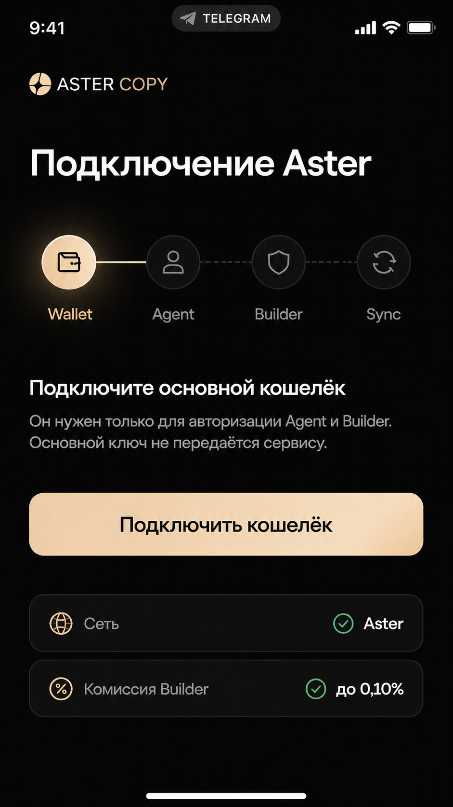
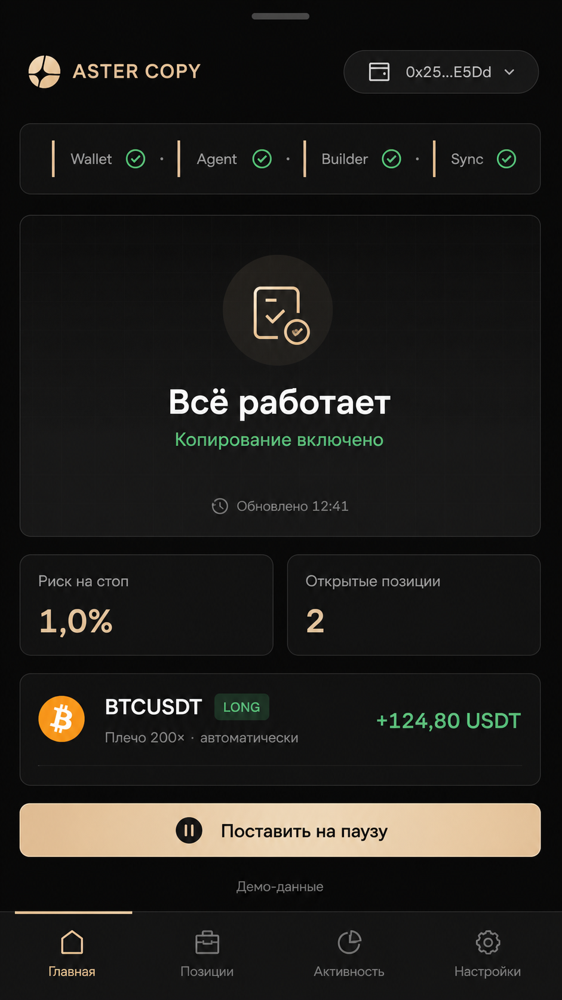
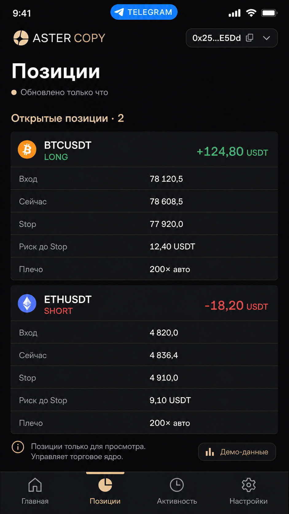
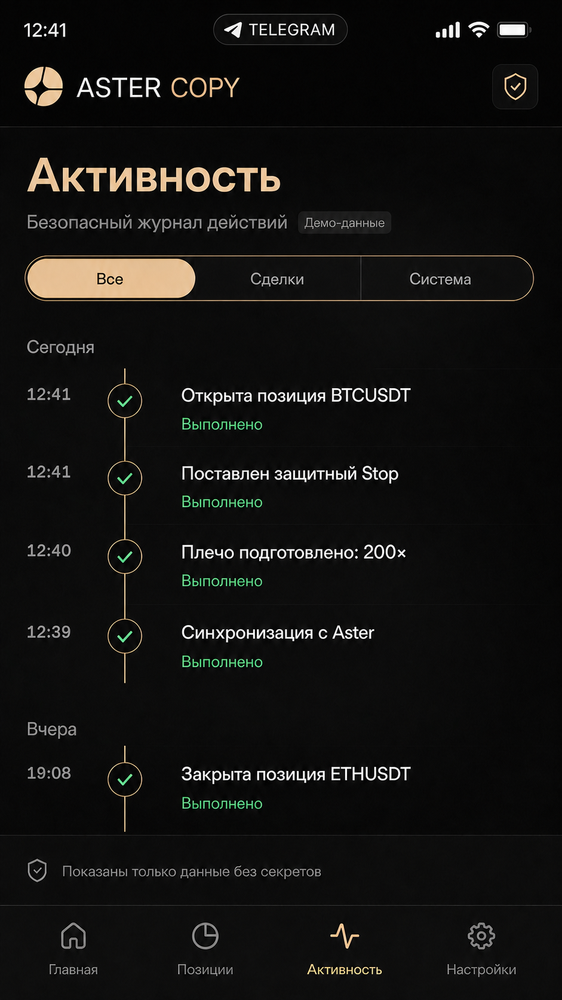
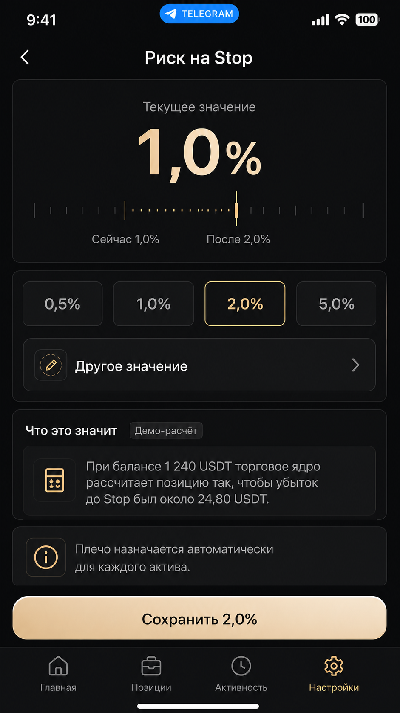
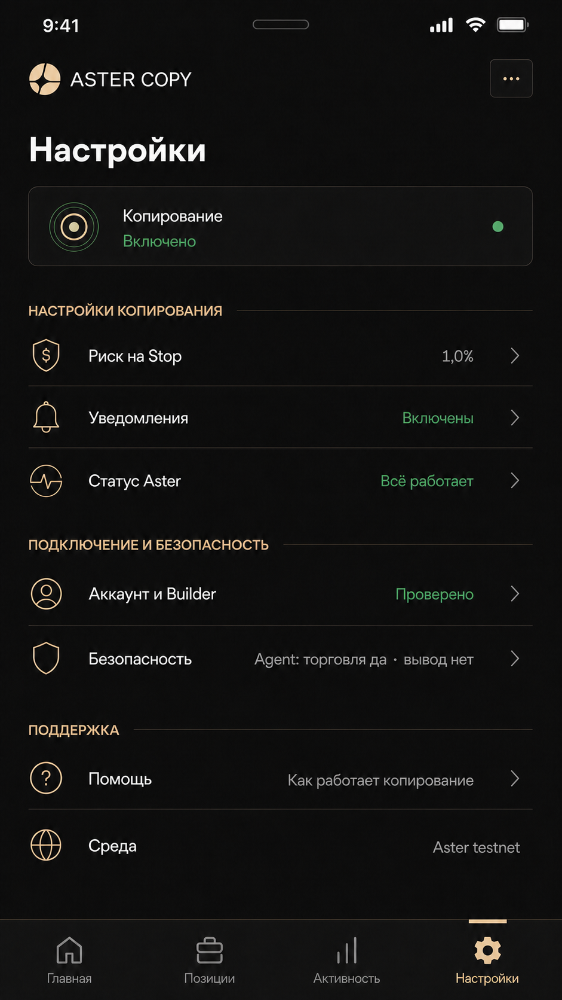
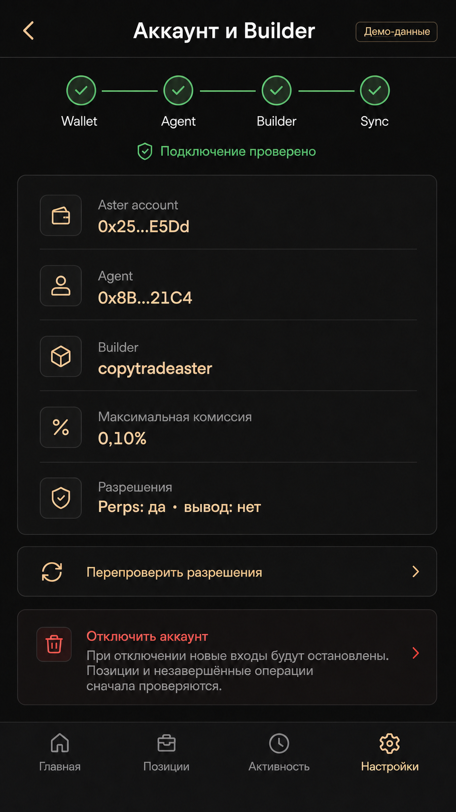
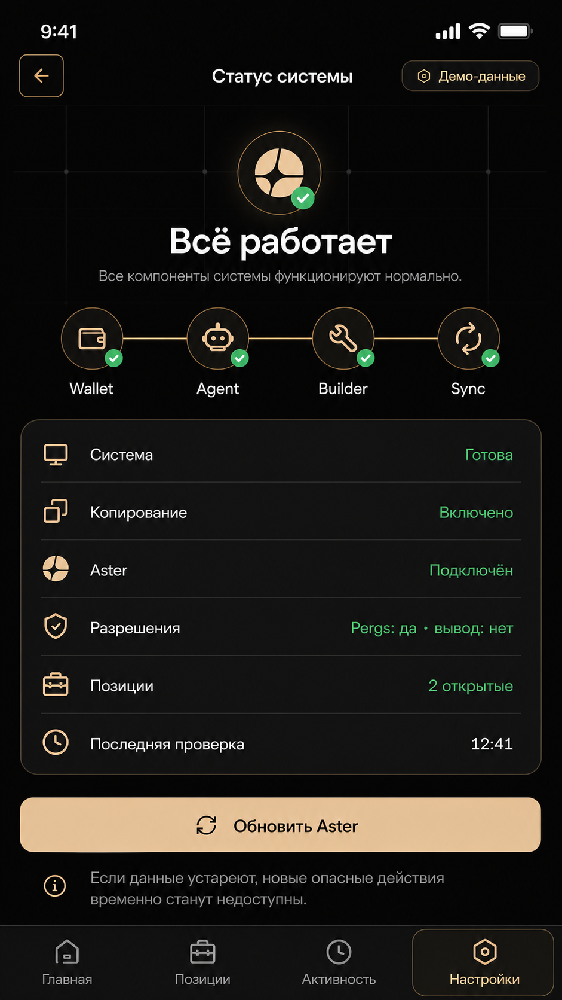

# Stage 3 — UI/UX-план Telegram Mini App

Дата исследования и генерации: 2026-08-26

Статус: **design/analysis only; разработка не начиналась**

Режим поверхности: `Operate`

Рабочее направление: **Aster Attestation Console**

Целевая среда первого прохода: Aster Futures testnet

## 1. Цель и границы

Этот документ задаёт пользовательскую архитектуру, визуальное направление,
экраны, состояния и недостающие application contracts для follower Mini App
Этапа 3. Он не является планом фронтенд-реализации и не меняет торговое ядро.

Mini App должна дать фолловеру безопасный способ:

1. авторизовать `Agent + Builder` подписью основного кошелька без передачи его
   private key;
2. понять состояние копирования и требуемое действие;
3. видеть свои позиции без ручного торгового управления;
4. менять только риск на защитный Stop;
5. ставить новые входы на паузу и возобновлять их с нужным подтверждением;
6. управлять уведомлениями и жизненным циклом подключения;
7. получать typed recovery вместо raw Aster payloads.

В первый follower Mini App не входят:

- ручная торговля, buy/sell/close/reverse;
- пользовательский leverage или entry deviation;
- follower emergency;
- deposit, withdrawal и transfer;
- admin global emergency и operator control panel;
- mainnet и реальные средства;
- реализация UI, HTTP presenter или wallet adapter.

Админский control plane разумно оставить в Telegram до отдельного surface
brief: он имеет другие задачи, частоту использования и уровень опасности.

## 2. Что изучено

Основа решения:

- `AGENTS.md` и `docs/docs_map.md`;
- `PRODUCT.md`;
- `docs/DEV_PLAN_SKELETON.md`, особенно Stage 3;
- `docs/ARCHITECTURE.md`, включая application/onboarding boundaries и §16;
- `docs/reports/STAGE2_CURRENT_STATE_AND_READINESS_2026-08.md`;
- `docs/reports/STAGE2_TELEGRAM_UX_BRIEF_2026-08.md`;
- `docs/ASTER_API_RESEARCH_2026-08.md`, особенно Builder/Aster Code §9;
- фактические `DashboardDTO`, `StatusDTO`, `RiskDTO`, `ActivityPage`,
  `NotificationSettingsDTO` и `ApplicationProtocol`;
- четыре предоставленных скриншота Aster как визуальные референсы.

Внешний web research не проводился: локальный API research обновлён в том же
месяце и содержит нужный Builder-flow, endpoints и testnet-проверки.

## 3. Неподвижная продуктовая правда

UI не имеет права менять эти правила:

- копируется целевое состояние, а не буквально команды мастера;
- WebSocket — быстрый сигнал, REST snapshot/reconciliation — источник
  восстановимого фактического состояния;
- pause запрещает новые входы/увеличения, но не закрытия, сокращения и защиту;
- follower меняет только `risk_percent`;
- leverage выбирается автоматически для каждого symbol;
- follower emergency отсутствует в UI/application boundary;
- private key основного кошелька не вводится и не передаётся сервису;
- Builder генерирует и хранит отдельный signer/Agent для пользователя;
- Futures Builder fee ограничен API-капом `0.001` = `0,10%`;
- после подключения account публикуется на паузе;
- Bot и Mini App используют один `UserApplicationService`, а не две бизнес-
  реализации;
- текущий scope остаётся testnet-only.

## 4. Design brief

### Job и аудитория

Фолловер открывает Mini App из private Telegram, обычно чтобы за 5–15 секунд
ответить на четыре вопроса:

1. Подключение и разрешения валидны?
2. Копирование активно, на паузе или заблокировано?
3. Есть ли открытые позиции и подтверждённая защита?
4. Нужен ли от меня следующий безопасный шаг?

### Outcome

Первый экран показывает одно общее состояние, его доказательство и одну
контекстную primary action. Пользователь не обязан понимать signing contexts,
nonce, journal, reconciliation или внутренние идентификаторы.

### Структурный тезис

**Сначала доказательство доверия, затем управление.** Узкая линия
`Wallet → Agent → Builder → Sync` показывает, где именно находится
авторизация/синхронизация. Ниже интерфейс возвращается к ежедневной задаче:
состояние, риск, позиции, действие.

### Anti-goals

- не уменьшать Aster trading terminal до размера телефона;
- не строить интерфейс вокруг графика или PnL;
- не использовать геймификацию, неоновые crypto-gradient и glassmorphism;
- не превращать каждую строку в карточку;
- не показывать цвет без текстового статуса;
- не делать опасное действие соседним с ежедневными настройками.

## 5. Визуальный язык Aster

### Что переносится из референсов

- почти чёрное поле и тонкая модульная сетка;
- тёплый champagne как цвет идентичности и primary action;
- нейтральные тёмные панели с малоконтрастной границей;
- крупные tabular цифры и точная колоночная геометрия;
- зелёный/красный только для подтверждённого результата;
- плотная, но спокойная операционная иерархия;
- pill допустим для primary action/segmented control, но не для каждого блока.

### Предварительные токены для будущего prototype

Это не официальный Aster design system и не готовые CSS values. Значения
нужно сверить с фактическими brand assets перед реализацией.

| Роль | Предварительное значение | Правило |
|---|---:|---|
| Canvas | `#070707` | базовый фон |
| Surface | `#121212` | основной рабочий слой |
| Elevated | `#181818` | только для modal/confirmation |
| Grid/border | `#252525` | 1 px, без декоративного шума |
| Text primary | `#F5F3EF` | основной текст |
| Text secondary | `#918F8C` | пояснения и freshness |
| Champagne | `#F2C98D` | brand, active tab, primary action |
| Success | `#28C985` | только подтверждённое состояние |
| Warning | `#D9A45F` | stale/pending, всегда с текстом |
| Danger | `#FF5D63` | ошибка или destructive action |

Шрифт Aster по скриншотам не идентифицирован. До появления проверенного brand
font следует использовать нейтральный современный sans/system fallback,
tabular numerals и не выдавать его за официальный шрифт Aster. Сгенерированный
logo mark — композиционный placeholder; в продукт должен попасть только
проверенный исходный asset или временный текстовый wordmark.

### Геометрия и density

- базовый spacing rhythm: 4/8/12/16/24/32;
- touch target: не меньше 44×44 CSS px;
- контентный край: 16 px на узком viewport, 20 px на широком;
- панели: 12–16 px radius; крупные pills — только для action/segmented control;
- числа выравниваются по правому краю и используют tabular figures;
- bottom navigation всегда содержит ровно четыре пункта.

## 6. Информационная архитектура

```text
Telegram launch / init session
├── Access pending / rejected / expired
├── Builder onboarding
│   ├── Connect wallet
│   ├── Review permissions + fee cap
│   ├── Sign Agent/Builder authorization
│   ├── Verify Aster + account preflight
│   └── Success (paused)
└── App shell
    ├── Главная
    │   ├── Pause
    │   ├── Resume confirmation
    │   └── Status/recovery
    ├── Позиции
    │   └── Position details (read-only)
    ├── Активность
    │   └── Pagination/filter
    └── Настройки
        ├── Risk on Stop
        ├── Notifications
        ├── System status
        ├── Account + Builder
        ├── Security
        └── Help
```

Bottom navigation не меняется между экранами:
`Главная / Позиции / Активность / Настройки`. Status, Risk и Account — вложенные экраны, а не пятый
tab. Максимальная обычная глубина — два перехода от root.

## 7. Экраны и состояния

### 7.1 Access/session gate

До wallet-flow Mini App проверяет Telegram session и application access.
Клиентский Telegram ID не является авторизацией; UI получает только результат
server-side проверки.

Состояния:

- `loading`: короткий skeleton без ложного «успеха»;
- `pending`: заявка уже у администратора, повторная отправка не нужна;
- `rejected`: причина общего класса + вернуться в bot/help;
- `approved/no account`: открыть Builder onboarding;
- `approved/connected`: открыть Home;
- `session invalid`: закрыть Mini App и открыть его заново из bot button.

### 7.2 Builder onboarding



Шаги:

1. `Кошелёк`: подключить поддерживаемый wallet и проверить сеть.
2. `Review`: показать user address, Agent address, Builder identity,
   `maxFeeRate`, права Perps/withdrawal и срок действия до подписи.
3. `Agent/Builder`: запросить только management signature. Основной private
   key остаётся в wallet.
4. `Sync`: server-side подтвердить Agent и Builder, затем выполнить balance /
   position / open-order / position-mode preflight.
5. `Success`: account connected, copying paused, primary action — проверить
   risk.

UI не должен жёстко обещать количество подписей. Research допускает combined
approval через параметры Builder в Agent flow и отдельные approve endpoints.
Presenter должен получить `signature_plan` от backend и показать один или два
wallet prompts без изменения общей топологии.

Typed failures:

- wallet отклонил подпись;
- неверная сеть;
- approval истёк/stale nonce;
- Agent не подтверждён;
- Builder не подтверждён или fee cap отличается;
- Perps запрещены / withdrawal разрешён;
- Hedge mismatch;
- account не пуст;
- Aster временно недоступен.

Raw payload, signature bytes, private key и stack trace не показываются.

### 7.3 Home



Home отвечает на состояние, а не перечисляет функции.

| State | Заголовок | Primary action | Вторичный смысл |
|---|---|---|---|
| Empty | Аккаунт не подключён | Подключить Aster | security/how it works |
| Active | Всё работает | Поставить на паузу | риск, позиции, freshness |
| Paused | Новые входы на паузе | Возобновить | защита/закрытия продолжаются |
| Stale | Нужна проверка | Обновить Aster | последние сохранённые данные |
| Blocked | Требуется действие | Исправить подключение | точная typed причина |
| Global pause/emergency | Система остановила новые входы | Подробнее | follower не может снять |

Pause — one-tap idempotent. Resume всегда имеет confirmation; если master уже
в позиции, confirmation отдельно объясняет возможный вход по текущей цене и
targeted reconciliation.

### 7.4 Positions



Экран только для наблюдения. На нём нет `Close`, `Reverse`, `Buy`, `Sell` и
редактирования leverage.

Для каждой позиции нужны:

- symbol и side;
- quantity/notional по принятому продуктовым owner формату;
- entry и mark;
- unrealized PnL;
- подтверждённый Stop и optional TP;
- риск до Stop, только если он может быть доказан актуальным snapshot;
- фактический leverage с подписью `автоматически`;
- freshness и protection state.

Обязательные состояния: loading, empty, stale, missing protection, partial
fill/reconciling, one position и 10+ positions. Если Stop отсутствует или
не подтверждён, UI не считает приблизительный risk молча: показывает
`Защита требует проверки` и ссылку на Status.

Отдельной вкладки `История` в эталоне нет: она дублировала бы Activity.
Добавлять её можно только после определения отдельного position-history DTO
и самостоятельного пользовательского job.

### 7.5 Activity



Это безопасный пользовательский ledger, а не execution journal dump.

Показывать:

- локальное время;
- понятное действие;
- terminal/pending result;
- symbol, когда он нужен для понимания;
- cursor pagination и фильтры `Все / Сделки / Система`.

Не показывать: addresses, clientOrderId, command hash, nonce, raw exchange
code, payload или traceback. Pending row обязан показывать age и recovery
после разумного timeout, чтобы `Выполняется` не выглядело бесконечным.

### 7.6 Risk on Stop



Это единственная числовая follower setting. Экран содержит:

- текущее значение;
- server-provided presets;
- custom decimal input;
- consequence preview на явно помеченных demo data;
- пояснение, что leverage назначается автоматически;
- confirmation summary перед сохранением.

Эталон показывает dirty state `Сейчас 1,0% → После 2,0%`, а не выдуманный
глобальный диапазон. Перед реализацией backend должен отдать `min`, `max`,
`step` и `presets`; frontend не определяет policy самостоятельно.

### 7.7 Settings



Разделы:

1. `Копирование`: риск, notifications, Status.
2. `Подключение и безопасность`: Account + Builder, permissions/security.
3. `Поддержка`: how copying works, pause semantics, testnet environment.

В эталоне используется один пункт `Аккаунт и Builder`; `Подключение и
безопасность` является только section heading. Статическое значение среды
`Aster testnet` не получает chevron и не притворяется navigation.

### 7.8 Account + Builder



Экран показывает attestation, а не секреты:

- masked Aster account;
- masked Agent;
- Builder identity;
- фактический `maxFeeRate`;
- Perps/withdrawal/IP/expiry summary;
- время последней server-side проверки.

Actions:

- `Перепроверить разрешения` — read-only refresh;
- `Переавторизовать` — только при typed blocked/expiring state;
- `Отключить аккаунт` — отдельный destructive flow.

Disconnect confirmation перечисляет scope: сначала pause, затем проверка
positions/open orders/in-flight, после этого удаление runtime binding и
секрета Agent. Отзыв Agent/Builder на стороне Aster должен быть отдельным
явным выбором, если backend действительно реализует этот endpoint-flow.

### 7.9 System status



Строки status являются read-only диагностикой и в эталоне не имеют chevrons.
Если будущая строка действительно откроет remediation/details, интерактивность
добавляется только ей, вместе с соответствующим application use case.

Topology не меняется между состояниями:

- ready — зелёный + текст;
- stale/pending — amber + age + refresh;
- degraded — последняя сохранённая информация и заблокированные risky actions;
- blocked — конкретная причина и одна remediation action;
- refresh failed — старые данные остаются видимыми, failure не стирает screen.

## 8. Анализ сгенерированных изображений

| Файл | Что получилось хорошо | Что исправить перед разработкой |
|---|---|---|
| `01-builder-auth` | trust rail объясняет Stage 3 flow; нет secret input; scope назван `Agent + Builder` | fee и signature plan всегда приходят из backend |
| `02-home-active` | сильная hierarchy: state → proof → risk/positions → action | позиционный preview строится только из свежего DTO |
| `03-positions` | read-only природа очевидна; отсутствует неподтверждённая History | risk до Stop показывается только из доказуемых protection data |
| `04-activity` | последовательная timeline без ложного зависшего события | реальный pending state обязан показывать age и recovery |
| `05-risk-settings` | показан осмысленный dirty state и consequence preview | min/max/step/presets задаёт backend |
| `06-settings` | нет дублирования connection; статическая среда не выглядит ссылкой | состав строк следует capabilities пользователя |
| `07-account-builder` | разрешения и fee видны без секретов; demo badge вынесен из safe area | disconnect всегда использует confirmation |
| `08-system-status` | read-only diagnostics не притворяются navigation | реальные stale/blocked states добавляют age и typed remediation |

Общий verdict: визуальный язык убедительно наследует Aster, а направление
работает именно как control surface. Главный риск будущей реализации —
скатиться либо в декоративный crypto dashboard, либо в набор одинаковых
rounded cards. Сохранить нужно сетку, правое выравнивание значений, trust rail,
ограниченную палитру и одну primary action на экран.

## 9. Недостающие application contracts Stage 3

Текущий Stage 2 contract достаточен для Home/Status/Risk/Activity/
Notifications, но Mini App/Builder требует явных расширений.

### 9.1 Session/auth

```text
MiniAppSessionDTO
- user_id (server-derived)
- access_state
- role/capabilities
- environment
- account_state
```

### 9.2 Builder onboarding

```text
BuilderOnboardingDTO
- step/status
- user_address_masked
- signer_address_masked
- builder_name/address_masked
- max_fee_rate
- signature_plan
- permissions requested
- expires_at
- typed_error/remediation
```

Нужны use cases `begin_builder_onboarding`, `prepare_authorization`,
`submit_wallet_signature`, `builder_status`, `refresh_builder_permissions`,
`reauthorize_builder` и безопасный disconnect/revoke flow. Названия не
фиксируют реализацию; важно сохранить transport-neutral boundary.

### 9.3 Positions

Текущий `DashboardDTO.open_positions` содержит только count. Нужен read-only
`PositionPageDTO/PositionSummaryDTO` с freshness/protection state. Presenter
не должен собирать risk/PnL из разрозненных transport payloads.

### 9.4 Risk constraints

`RiskDTO` должен вернуть UI constraints (`min/max/step/presets`) либо отдельный
policy metadata DTO. Иначе frontend вынужден выдумать безопасный диапазон.

### 9.5 Status

`StatusDTO` нужно дополнить Builder attestation: approved builder, фактический
fee cap, signer source, validation age и typed remediation. Raw endpoint
responses остаются внутри adapter/application layer.

## 10. Interaction, feedback и accessibility

- Telegram safe insets и dynamic viewport учитываются на каждом экране;
- основной mobile range: 360–430 CSS px; на широком экране content column не
  растягивается до desktop terminal density;
- status не кодируется одним цветом;
- focus order совпадает с визуальным order;
- touch target минимум 44×44;
- значения и labels имеют достаточный contrast, muted text не используется
  для критических предупреждений;
- loading skeleton сохраняет геометрию и не показывает ложные numbers;
- destructive action визуально отделено и требует summary + confirmation;
- double tap не запускает две mutation;
- stale response не перетирает новое состояние;
- motion ограничен progress trust rail, row state и refresh; reduced-motion
  сохраняет полное понимание без animation;
- Russian decimal/time formatting единообразны; адреса всегда masked.

## 11. Definition of Done будущей реализации

- [ ] ровно четыре root tabs на всех основных экранах;
- [ ] Builder onboarding не принимает main wallet private key;
- [ ] permissions и fee показаны до wallet signature;
- [ ] one/two-signature flow определяется backend plan;
- [ ] success публикует account paused;
- [ ] Home покрывает empty/active/paused/stale/blocked/global states;
- [ ] Positions read-only и показывают protection/freshness;
- [ ] risk — единственная follower numeric setting;
- [ ] leverage/deviation/emergency отсутствуют даже при forged input;
- [ ] Activity не раскрывает secrets/raw payloads;
- [ ] disconnect и resume используют typed confirmation;
- [ ] Mini App использует общий application service;
- [ ] все generated placeholder data удалены или явно помечены;
- [ ] exact Aster logo/font assets подтверждены отдельно;
- [ ] ready/stale/degraded/error/empty/loading состояния проверены на целевых
  mobile viewport;
- [ ] testnet signed Builder flow и UI recovery пройдены до mainnet discussion.

## 12. Решения, которые нельзя выдумывать при реализации

1. поддерживаемый wallet provider и EVM/Solana scope первого запуска;
2. combined или separate signature plan для конкретного adapter;
3. фактические Builder address/name/feeRate и политика их изменения;
4. продуктовый min/max/step/presets для `risk_percent`;
5. точный Position DTO и нужен ли отдельный position history;
6. поведение revoke Agent/Builder при disconnect;
7. будет ли когда-либо отдельный admin Mini App;
8. официальный logo/font/icon asset Aster.

## 13. Артефакты и provenance

Изображения созданы встроенным `imagegen` в режиме `ui-mockup`. Экраны
`01/03/04/05/06/07/08` прошли точечный `precise-object-edit`; композиционный
эталон `02-home-active` сохранён без пересборки. Все восемь PNG лежат в
`docs/reports/assets/stage3-mini-app/reference-templates/`; exact prompts сохранены рядом в
`*.prompt.txt` и встроены в PNG metadata (`impeccable:prompt`). Все значения,
адреса, PnL и времена на изображениях — synthetic demo data.

## 14. Журнал

### 2026-08-26

- изучены product, roadmap, architecture, Stage 2 readiness/UX и Builder API
  research;
- проверены transport-neutral DTO/use cases текущего application layer;
- разобраны четыре визуальных референса Aster;
- через `impeccable shape` выбран `Operate`-концепт Aster Attestation Console;
- сгенерированы и визуально проверены восемь экранов;
- исправлены два дефекта навигации в activity/risk images;
- зафиксированы IA, screen states, UI corrections, missing DTOs и Definition
  of Done;
- исходный код и тесты не изменялись.

### 2026-08-26 — corrective polish pass

- повторный `impeccable critique` оценил первый набор в `26/40` и выявил
  четыре material defects плюс три plan-alignment corrections;
- арт-направление и `02-home-active` сохранены;
- исправлены onboarding terminology, Positions IA, Activity chronology,
  Risk dirty state, Settings duplication, Account safe area и Status
  affordances;
- эталоны повторно просмотрены единым contact sheet; exact prompts обновлены
  и повторно встроены в PNG metadata.
